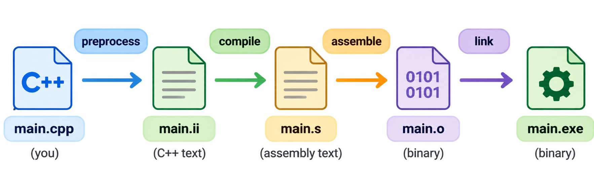
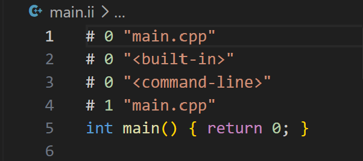
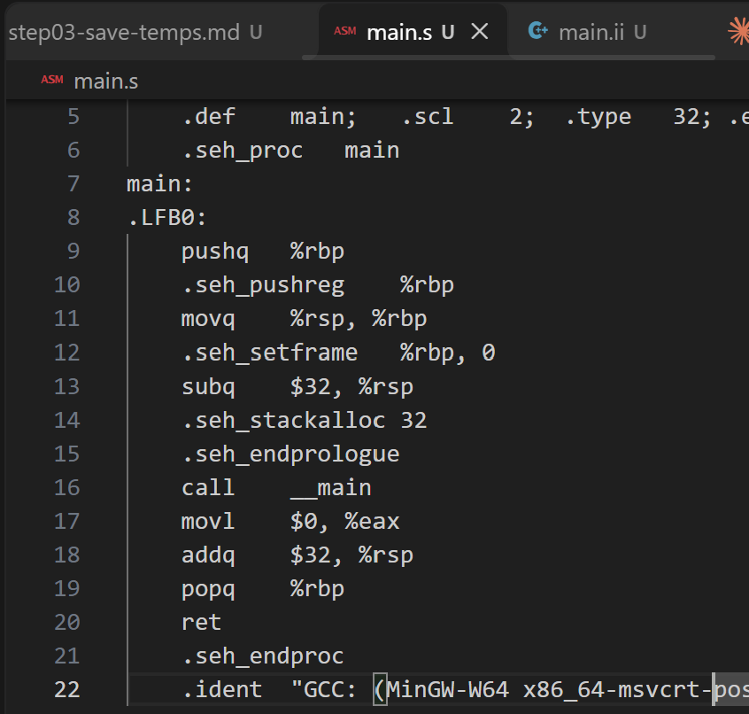
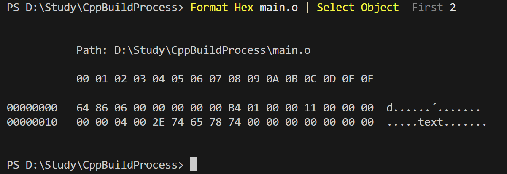

# Step 03 — Keep the intermediate files with `-save-temps`

## Goal
In Step 02 we saw that g++ creates `.s` and `.o` files in the Temp folder and then deletes them.
This step keeps them **next to `main.cpp`** so we can open and look at the output of each stage.

## Changes in this commit
- **No code changes.** `main.cpp` stays the same.
- `.gitignore`: no change
- This doc file and one line in the README.

## Concepts
`-save-temps` = "do the same build, but don't delete the intermediate files".
Their names come from the source file name (`main.cpp` → `main.*`):



| File | Stage that produced it | Content | Readable? |
|---|---|---|---|
| `main.ii` | Preprocessor | C++ code after `#include`/`#define` are processed | Text |
| `main.s` | Compiler | x86-64 assembly | Text |
| `main.o` | Assembler | Machine code + symbol table (COFF format on Windows) | **Binary** |
| `main.exe` | Linker | The final program | Binary |

Note: in Step 02, `cc1plus` seemed to do preprocess + compile at once and never wrote a `.ii` file.
With `-save-temps`, g++ splits this into two separate calls to `cc1plus` (one with `-E` to preprocess),
so the `.ii` file appears. Check with:
```powershell
g++ -v -save-temps main.cpp -o main.exe 2>&1 | Select-String "cc1plus.exe -|as.exe -|collect2.exe -"
```
Expect **4** lines now: `cc1plus.exe -E ...` (preprocess → `main.ii`), `cc1plus.exe -fpreprocessed main.ii ...`
(compile → `main.s`), `as.exe -v -o main.o main.s`, `collect2.exe ...`.
Notice the file names are no longer random Temp names.

## Do it by hand (PowerShell, in the repo root)

### 1. Build and keep everything
```powershell
g++ -save-temps main.cpp -o main.exe
ls main.*
```
Expect: no output from g++, then `ls` lists **5 files**:
```
main.cpp   (25 bytes)
main.exe   (~54 KB)
main.ii    (~98 bytes)
main.o     (~768 bytes)
main.s     (~447 bytes)
```

### 2. Look at the preprocessed file
```powershell
cat main.ii
```
Expect:


- Lines starting with `#` are **line markers**: they tell the compiler "the following lines came from file X, line N".
  That is how error messages can still say `main.cpp:1:22` after preprocessing.
- Our code has no `#include`, so the preprocessor has almost nothing to do. (That changes in the next steps.)

### 3. Look at the assembly
```powershell
cat main.s
```
Expect (22 lines), the important part:

- `movl $0, %eax` → the return value goes into the `eax` register. That is how `0` becomes the exit code.
- `call __main` → we never wrote this! MinGW adds it to run global constructors before your code.
- Lines starting with `.` (`.globl main`, `.seh_proc` ...) are **directives** for the assembler, not CPU instructions.
  `.globl main` means "make the symbol `main` visible to the linker".

### 4. Look at the object file
```powershell
Format-Hex main.o | Select-Object -First 2
```
Expect:

- `64 86` = the magic number for an **x86-64 COFF** object file (the Windows format).
- `.text` = the name of the section that holds the machine code.
- Don't try to read `main.o` with `cat`; it is binary. Later steps will use real tools (`nm`, `objdump`).

### 5. Experiment: where does a failing build stop?
Remove the `;` after `return 0`, then:
```powershell
del main.ii, main.s, main.o
g++ -save-temps main.cpp -o main.exe
ls main.*
```
Expect: the error `main.cpp:1:22: error: expected ';' before '}' token`, and then:
- `main.ii` **exists** (~95 bytes) → preprocessing succeeded,
- `main.s` exists but is almost empty (~18 bytes, just `.file "main.cpp"`) → compiling failed,
- **no new `main.o`** → the assembler never ran.

The files tell you exactly which stage failed. Put the `;` back and rebuild.

## Errors you may hit at this step

| What you do | Message | Meaning |
|---|---|---|
| Typo `-save-temp` (no `s`) | `g++.exe: error: unrecognized command-line option '-save-temp'; did you mean '-save-temps'?` | Reported by the driver; nothing ran |
| `cat main.o` | Screen full of garbage characters | `.o` is binary. Use `Format-Hex` |
| Syntax error in `main.cpp` | `expected ';' before '}' token` + only `main.ii` (and an empty `main.s`) are produced | The pipeline stops at the **compile** stage |
| Forgot `.gitignore` change | `git status` shows `main.ii`, `main.s`, `main.o` as untracked | Generated files should not be committed |

👉 Next step: run each stage **one at a time** by hand (`-E`, `-S`, `-c`), instead of letting `-save-temps` do it all.
