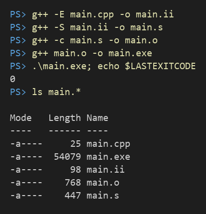
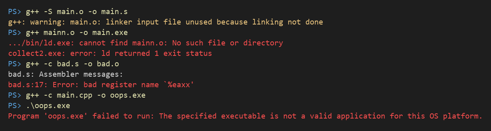

# Step 04 — Run each stage by hand: `-E`, `-S`, `-c`, link

## Goal
In Step 03, `-save-temps` ran all 4 stages for us and kept the files.
Now **we** are the driver: we run each stage with its own command and choose each output file name.

## Changes in this commit
- **No code changes.** `main.cpp` stays the same.
- This doc file, 2 images, and one line in the README.

## Concepts
Each flag tells g++ "**stop after** this stage":

| Command | Stage run | Stops after | Input → Output |
|---|---|---|---|
| `g++ -E main.cpp -o main.ii` | preprocess | preprocessing | `.cpp` → `.ii` |
| `g++ -S main.ii -o main.s` | compile | compiling | `.ii` → `.s` |
| `g++ -c main.s -o main.o` | assemble | assembling | `.s` → `.o` |
| `g++ main.o -o main.exe` | link | (nothing, full run) | `.o` → `.exe` |

How does g++ know where to **start**? From the **file extension** of the input:
- `.cpp` → start at preprocess
- `.ii` → already preprocessed, start at compile
- `.s` → start at assemble
- `.o` → only link

Memory trick: **`-E`**, **`-S`**, **`-c`** → "**ESc**" (the Escape key), the order of the stages.

## Do it by hand (PowerShell, in the repo root)

### 1. The 4 stages, one at a time
```powershell
g++ -E main.cpp -o main.ii
g++ -S main.ii -o main.s
g++ -c main.s -o main.o
g++ main.o -o main.exe
.\main.exe; echo $LASTEXITCODE
ls main.*
```
Expect: the 4 `g++` commands print **nothing**, `echo` prints `0`, and `ls` shows the same sizes as in Step 03:



`git status` stays **clean**: `main.ii`, `main.s`, `main.o` are committed in the repo,
and the files you just made are byte-for-byte the same as the ones made by `-save-temps`.
→ Running the stages by hand and letting g++ do everything give **the same result**.

### 2. Without `-o`
```powershell
g++ -E main.cpp
```
Expect: the preprocessed code is printed to the **screen** (stdout) instead of a file —
the same 5 lines you saw in `main.ii` in Step 03. Only `-E` behaves like this.
`-S` and `-c` without `-o` write `main.s` / `main.o` into the **current folder**
(even for `g++ -c src\main.cpp` — the `.o` lands where you run the command, not in `src\`).

### 3. Skip stages
You don't have to stop at every stage. These also work:
```powershell
g++ -c main.cpp -o main.o     # preprocess + compile + assemble at once
g++ -S main.cpp -o main.s     # preprocess + compile at once
```
`g++ -c file.cpp -o file.o` is the command real build systems (Make, CMake, ...) run **for each `.cpp` file**.
The link step then runs once at the end with all the `.o` files. This will matter when we have more than one `.cpp`.

## Errors you may hit at this step



| What you do | Message | Meaning |
|---|---|---|
| `g++ -S main.o -o main.s` (input is already past that stage) | `g++: warning: main.o: linker input file unused because linking not done` | `.o` can only be linked, but `-S` says "stop before linking" → g++ has **nothing to do**. It's only a warning: exit code is 0 but **no file is made** |
| Typo in the object file name: `g++ mainn.o -o main.exe` | `ld.exe: cannot find mainn.o: No such file or directory` + `collect2.exe: error: ld returned 1 exit status` | A `.o` input goes straight to the **linker**, so the linker reports it (compare with Step 01, where a missing `.cpp` was reported by `cc1plus`) |
| Edit `main.s` by hand and break it (`%eax` → `%eaxx`), then `g++ -c bad.s -o bad.o` | `bad.s: Assembler messages:` / `bad.s:17: Error: bad register name '%eaxx'` | An **assembler** error. Format: `file:line: Error:` (no column, capital `E`). You will almost never see this with real code, because the compiler always writes valid assembly |
| `g++ -c main.cpp -o oops.exe`, then `.\oops.exe` | `Program 'oops.exe' failed to run: The specified executable is not a valid application for this OS platform.` | `-c` always makes an **object file**, whatever name you give it. A `.o` cannot run: it has no entry point and is not linked |
👉 Next step: skip `g++` completely and call the real tools ourselves (`as.exe`, then `ld.exe`).
