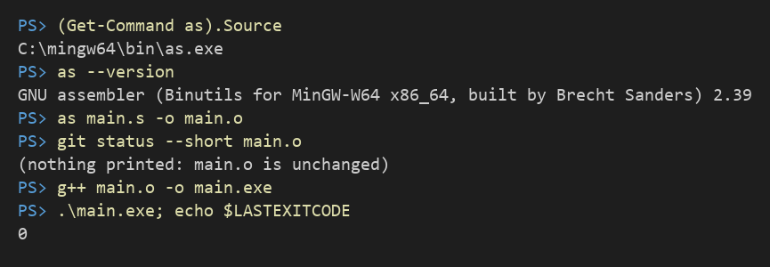
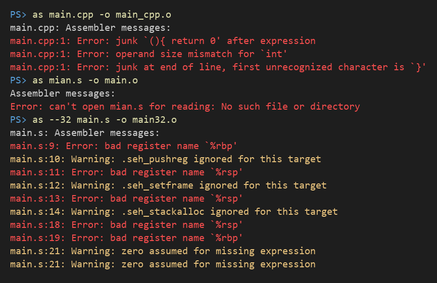

# Step 05 — Call the assembler `as` yourself (no `g++`)

## Goal
In Step 04 we still used `g++ -c main.s -o main.o`, but g++ only passes the job on to `as.exe` (see Step 02).
Now we **remove the middleman** and call the assembler directly.
This is the first stage we run **without g++**.

## Changes in this commit
- **No code changes.** `main.cpp` stays the same.
- This doc file, 2 images, and one line in the README.

## Concepts
- `as` = the **GNU assembler**, part of **binutils** (a separate package from GCC: `as`, `ld`, `nm`, `objdump`, ...).
- It only understands **assembly** (the `.s` file). It knows nothing about C++.
- `g++ -c main.s -o main.o` does exactly this (seen with `g++ -v -c main.s -o main.o`):
  ```
  c:/mingw64/.../x86_64-w64-mingw32/bin/as.exe -v -o main.o main.s
  ```
  That `as.exe` and `C:\mingw64\bin\as.exe` (the one on your PATH) are **byte-for-byte the same file**.

```
main.cpp ─(g++ -E)─▶ main.ii ─(g++ -S)─▶ main.s ─(as)─▶ main.o ─(g++)─▶ main.exe
                                                 ▲ this step: no g++ here
```

## Do it by hand (PowerShell, in the repo root)

### 1. Assemble with `as`
```powershell
(Get-Command as).Source
as --version
as main.s -o main.o
git status --short main.o
g++ main.o -o main.exe
.\main.exe; echo $LASTEXITCODE
```
Expect:
- `C:\mingw64\bin\as.exe`
- `GNU assembler (Binutils for MinGW-W64 x86_64, ...) 2.39`
- `as` prints **nothing** (success).
- `git status --short main.o` prints **nothing** → the `main.o` made by `as` is **identical** to the committed one made by `g++`.
- The linked program still returns `0`.



### 2. Look inside the job `as` did
Open `main.s` again. Each CPU instruction became a few bytes of machine code in `main.o`, for example:
```
pushq %rbp        →  55
movq  %rsp, %rbp  →  48 89 E5
movl  $0, %eax    →  B8 00 00 00 00     <-- your "return 0": B8 = "put a number in eax", then the number 0 (4 bytes)
ret               →  C3
```
(We will print these bytes with `objdump` in a later step.)

## Errors you may hit at this step



| What you do | Message | Meaning |
|---|---|---|
| Give C++ to the assembler: `as main.cpp -o main_cpp.o` | `main.cpp:1: Error: junk '(){ return 0' after expression` / `operand size mismatch for 'int'` | `as` reads `int` as if it were an assembly instruction. **Each tool only understands its own input format**. g++ picks the right tool from the file extension, `as` does not |
| Typo in the file name: `as mian.s -o main.o` | `Assembler messages:` / `Error: can't open mian.s for reading: No such file or directory` | Note the format is different from `cc1plus` and `ld` — every tool has its own error style |
| ⚠ Same command as above, when `main.o` already exists | (same error) — and then **`main.o` is gone** | When `as` fails, it **deletes the output file**, even an old good one. Check with `git status`: ` D main.o`. Get it back with `git restore main.o` |
| Wrong target: `as --32 main.s -o main32.o` | `main.s:9: Error: bad register name '%rbp'` + `Warning: .seh_pushreg ignored for this target` | `main.s` is **64-bit** assembly (`%rbp`, `%rsp` are 64-bit registers). In 32-bit mode they don't exist. The `.s` file is tied to one CPU architecture |
| `as main.s` with no `-o` | No error, but a file called **`a.out`** appears | `as` default output name is `a.out` (an old Unix name), not `main.o` |

👉 Next step: call the linker `ld` directly — and see why `g++` passes it so many extra files (`crt2.o`, `-lmsvcrt`, ...).
