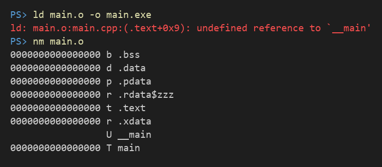
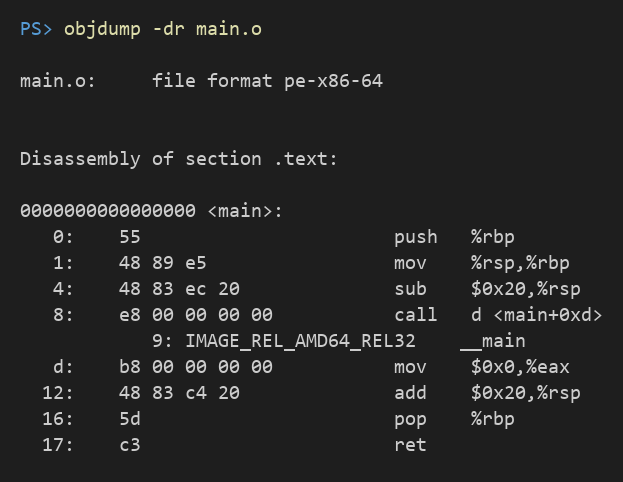
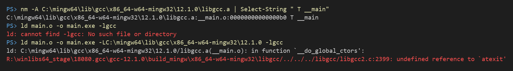

# Step 06 — Call the linker `ld` yourself: the first "undefined reference"

## Goal
Steps 04–05 still linked with `g++ main.o -o main.exe`. Now we try the real linker **`ld`** directly
and get the most famous C++ build error: **`undefined reference`**.
We won't make `ld` succeed yet (that is Step 07). This step is about **understanding the error**.

## Changes in this commit
- **No code changes.** `main.cpp` stays the same.
- This doc file, 3 images, and one line in the README.

## Concepts
### Symbols: "I have" and "I need"
Every `.o` file contains a **symbol table** — a list of names:
- **defined** symbols: "I **have** this function/variable" (`T` = in the `.text` code section)
- **undefined** symbols: "I **need** this, someone else must provide it" (`U`)

The **linker's main job**: match every `U` with a `T` from some other file. If it can't → `undefined reference`.

### Relocation: the hole in the machine code
When `as` assembled `call __main`, it did **not know** where `__main` would be.
So it wrote `e8 00 00 00 00` (`call` + a 4-byte **placeholder**), and left a note for the linker:
"at byte 9, put the address of `__main`". This note is a **relocation**.
The linker fills every hole — or fails if it can't find the symbol.

### Libraries: `-L` and `-l`
A **static library** (`.a`) is just an archive of many `.o` files.
- `-lgcc` = "search the library **`libgcc.a`**" (ld adds the `lib` prefix and `.a` suffix)
- `-L<dir>` = "look for libraries in this folder too"

## Do it by hand (PowerShell, in the repo root)

### 1. Link with `ld` only
```powershell
ld main.o -o main.exe
```
Expect (1 error, no exe is made):
```
ld: main.o:main.cpp:(.text+0x9): undefined reference to `__main'
```
Read it as: "in `main.o`, from source `main.cpp`, in section `.text` at byte `0x9`, someone needs `__main` and I can't find it".

### 2. Who needs what? `nm`
```powershell
nm main.o
```
Expect — look at the last 2 lines:
```
                 U __main      <-- U = undefined: main.o NEEDS __main
0000000000000000 T main        <-- T = defined in .text: main.o HAS main
```


`__main` is the hidden call we saw in `main.s` in Step 03 (`call __main`). **You** never wrote it; the compiler did.

### 3. Where is the hole? `objdump -dr`
```powershell
objdump -dr main.o
```
Expect: at address `8` the instruction `e8 00 00 00 00  call ...`, and below it the relocation `9: IMAGE_REL_AMD64_REL32  __main`.
→ Bytes 9..12 are the **4 zero bytes** waiting for the address of `__main`. That is the `+0x9` in the error message.



### 4. Who has `__main`? Search a library
```powershell
nm -A C:\mingw64\lib\gcc\x86_64-w64-mingw32\12.1.0\libgcc.a | Select-String " T __main"
```
Expect:
```
C:\mingw64\lib\gcc\x86_64-w64-mingw32\12.1.0\libgcc.a:__main.o:00000000000000b0 T __main
```
→ `libgcc.a` contains a member `__main.o` that **defines** (`T`) `__main`.

### 5. Give `ld` the library
```powershell
ld main.o -o main.exe -lgcc
ld main.o -o main.exe -LC:\mingw64\lib\gcc\x86_64-w64-mingw32\12.1.0 -lgcc
```
Expect:
- first command: `ld: cannot find -lgcc: No such file or directory` → `ld` doesn't know that folder.
- second command: the `__main` error is **gone**, but a **new** one appears:
  ```
  ld: ...libgcc.a(__main.o): in function `__do_global_ctors':
  ...libgcc2.c:2399: undefined reference to `atexit'
  ```
  → The linker took `__main.o` from `libgcc.a`, and **that** file has its own `U` symbols (`atexit`).
  Fixing one undefined reference can pull in more. This chain is why `g++` passes so many libraries to the linker (Step 02).



## Errors you may hit at this step

| What you do | Message | Meaning |
|---|---|---|
| `ld main.o -o main.exe` | `undefined reference to '__main'` | A `U` symbol with no matching `T`. **Link error** — the code compiled fine |
| `ld ... -lgcc` without `-L` | `ld: cannot find -lgcc: No such file or directory` | `ld` alone does not know where GCC's libraries live. `g++` adds all the `-L` folders for you |
| `-lgcc` but forgot the folder ends with `12.1.0` | Same `cannot find -lgcc` | Check the path: `ls C:\mingw64\lib\gcc\x86_64-w64-mingw32\` shows your GCC version |
| `ld ... -l gcc.a` or `-llibgcc` | `cannot find -lgcc.a` / `cannot find -llibgcc` (+ a hint: `use -l:libgcc.a or rename it to liblibgcc.a`) | Write only the middle part of the name: `libgcc.a` → `-lgcc`. (`-l:libgcc.a` with a colon = "use this exact file name") |
| Add `-lgcc` and get `undefined reference to 'atexit'` | (see above) | Not your mistake — a library has its own needs. Next step adds the rest |

> 💡 Remember Step 01? `int mian()` gave `undefined reference to 'WinMain'`. Same kind of error: some code needed
> a symbol (`main` → then `WinMain`) that nobody defined. `libmingw32.a` contains a fallback `main` that calls `WinMain`:
> `nm -A C:\mingw64\x86_64-w64-mingw32\lib\libmingw32.a | Select-String " T main$"`

👉 Next step: build the **complete** `ld` command (startup files `crt2.o`, `crtbegin.o`, `crtend.o` + the libraries) and get a working `main.exe` without `g++`.
