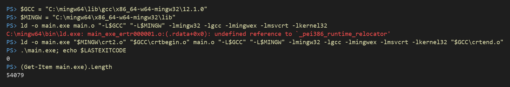
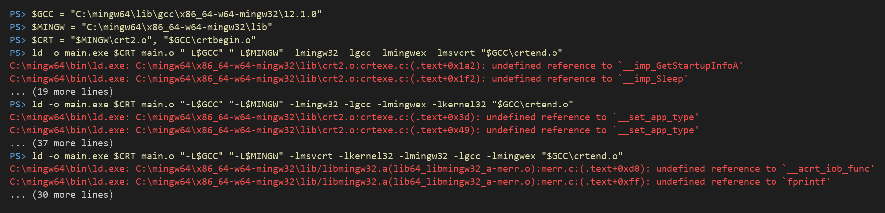

# Step 07 — A complete `ld` command: build `main.exe` without `g++`

## Goal
Step 06 ended with `undefined reference` errors. Now we give `ld` **everything** it needs and get a working
`main.exe` — the same file `g++` makes — with **no `g++` at all** in the link stage.

## Changes in this commit
- **No code changes.** `main.cpp` stays the same.
- This doc file, 2 images, and one line in the README.

## Concepts
Your `main()` is **not** where the program starts. The real start is the **C runtime (CRT) startup code**:

```
Windows loads main.exe
  └─▶ mainCRTStartup        (in crt2.o: the real entry point)
        ├─ set up the heap, stdio, command-line arguments (needs msvcrt, kernel32)
        ├─ calls main()      (YOUR code)
        │     └─ calls __main  (in libgcc / libmingw32: run global constructors)
        └─ calls exit() with the value main returned
```

What `g++` passed to the linker in Step 02, and why:

| Piece | What it is | Provides |
|---|---|---|
| `crt2.o` | CRT startup object | `mainCRTStartup` — the entry point that calls `main` |
| `crtbegin.o` / `crtend.o` | GCC begin/end markers | Register exception-handling frame info, constructor/destructor lists |
| `main.o` | **your code** | `main` |
| `-lmingw32` | MinGW runtime helpers | `__main`, pseudo-relocations, the fallback `main` → `WinMain` (Step 01!) |
| `-lgcc` | GCC helper library | `__main`, low-level helpers |
| `-lmingwex` | MinGW extensions | extra C functions not in msvcrt |
| `-lmsvcrt` | Microsoft C runtime DLL import library | `malloc`, `printf`, `exit`, `memcpy`, ... |
| `-lkernel32` | Windows API import library | `Sleep`, `GetStartupInfoA`, `VirtualProtect`, ... |

**Order matters**: `crt2.o crtbegin.o` → your `.o` files → libraries → `crtend.o`.
`ld` reads files **left to right** and only takes from a library what is **still undefined at that moment** (more in Step 16).

## Do it by hand (PowerShell, in the repo root)

### 1. Two shortcut variables (to keep the command readable)
```powershell
$GCC = "C:\mingw64\lib\gcc\x86_64-w64-mingw32\12.1.0"
$MINGW = "C:\mingw64\x86_64-w64-mingw32\lib"
```

### 2. Libraries only, no startup files
```powershell
ld -o main.exe main.o "-L$GCC" "-L$MINGW" -lmingw32 -lgcc -lmingwex -lmsvcrt -lkernel32
```
Expect: `undefined reference to '_pei386_runtime_relocator'` — the startup code is missing.

### 3. The full command
```powershell
ld -o main.exe "$MINGW\crt2.o" "$GCC\crtbegin.o" main.o "-L$GCC" "-L$MINGW" -lmingw32 -lgcc -lmingwex -lmsvcrt -lkernel32 "$GCC\crtend.o"
.\main.exe; echo $LASTEXITCODE
(Get-Item main.exe).Length
```
Expect: `ld` prints **nothing**, the program returns `0`, and the size is **54079** bytes —
exactly the same size as the `main.exe` made by `g++ main.o -o main.exe`.



🎉 You have now done **every stage by hand**: `g++ -E` → `g++ -S` → `as` → `ld`.
(Only preprocessing and compiling still go through `g++`, because `cc1plus.exe` is hidden in
`C:\mingw64\libexec\gcc\...` and needs many internal flags.)

### 4. Experiment: remove one piece at a time
```powershell
$CRT = "$MINGW\crt2.o", "$GCC\crtbegin.o"
ld -o main.exe $CRT main.o "-L$GCC" "-L$MINGW" -lmingw32 -lgcc -lmingwex -lmsvcrt "$GCC\crtend.o"
ld -o main.exe $CRT main.o "-L$GCC" "-L$MINGW" -lmingw32 -lgcc -lmingwex -lkernel32 "$GCC\crtend.o"
ld -o main.exe $CRT main.o "-L$GCC" "-L$MINGW" -lmsvcrt -lkernel32 -lmingw32 -lgcc -lmingwex "$GCC\crtend.o"
```
Expect: each one fails with a **long** list of `undefined reference` (first 2 lines shown):



Read the names to guess **which library is missing**:
- `__imp_Sleep`, `__imp_GetStartupInfoA` → `__imp_` + a Windows API name → **kernel32** is missing.
- `__set_app_type`, `malloc`, `memset`, `exit` → C runtime functions → **msvcrt** is missing.
- Same libraries but **msvcrt/kernel32 first** → `fprintf`, `fwrite` undefined even though `-lmsvcrt` IS in the command!
  `ld` already passed `msvcrt` before `libmingw32` asked for `fprintf`. **Library order matters.**

## Errors you may hit at this step

| What you do | Message | Meaning |
|---|---|---|
| No `crt2.o` | `undefined reference to '_pei386_runtime_relocator'` | No startup code. `ld` itself doesn't know a program needs a CRT; `g++` adds it |
| No `-lkernel32` | `undefined reference to '__imp_GetStartupInfoA'`, `'__imp_Sleep'`, ... | `__imp_X` = "pointer to function X **imported from a DLL**". These are Windows API functions in `kernel32.dll` |
| No `-lmsvcrt` | `undefined reference to '__set_app_type'`, `'malloc'`, `'exit'`, ... | C standard library functions live in `msvcrt.dll` |
| No `-lmingwex` | `undefined reference to '_MINGW_INSTALL_DEBUG_MATHERR'` | MinGW-specific helpers |
| Libraries in the wrong order | `undefined reference to 'fprintf'` even with `-lmsvcrt` present | `ld` scans left → right, once. A library must come **after** whoever needs it |
| Forgot to set `$GCC` / `$MINGW` (new PowerShell window) | `ld: cannot find \crt2.o: No such file or directory` | An empty variable makes the path `\crt2.o`. Set the variables again |
| `ld ... "-L $GCC"` (space after `-L`) | `cannot find -lgcc` | With quotes, the space becomes part of the path. Write `"-L$GCC"` |

> 💡 Only `crt2.o` is strictly needed for this tiny program: without `crtbegin.o`/`crtend.o` it still links and runs
> (50469 bytes), but exceptions and some global constructors would break in bigger programs. Always use the full list `g++ -v` shows.

👉 Next step: back to the **preprocessor** — add `#include <cstdio>` and watch `main.ii` grow from 5 lines to hundreds.
