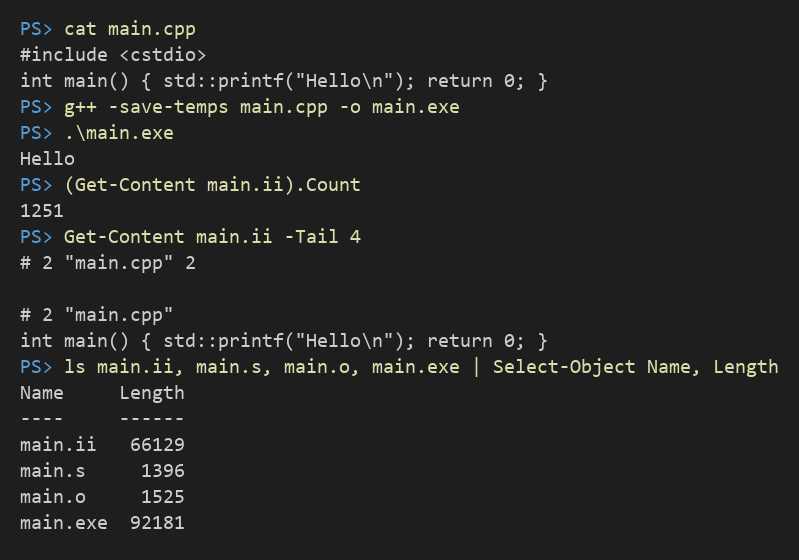
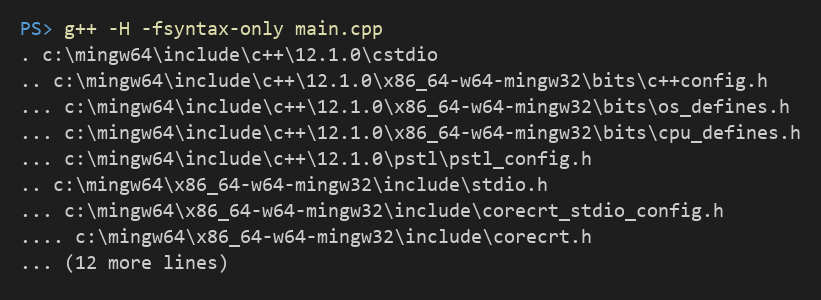
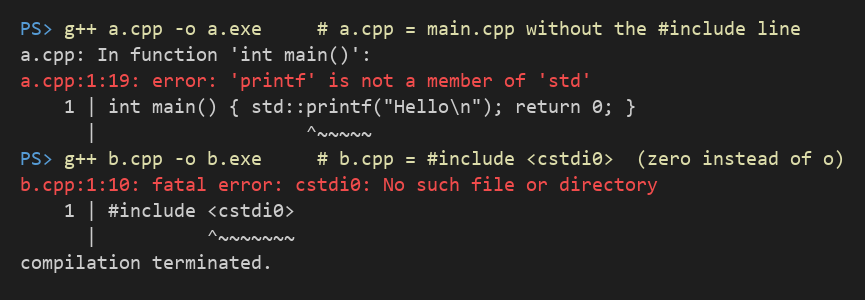

# Step 08 — `#include <cstdio>`: the preprocessor copies whole files

## Goal
Until now the preprocessor had nothing to do (`main.ii` = 5 lines).
We add **one** `#include` and print `Hello` — and watch `main.ii` grow to **1251 lines**.

## Changes in this commit
- `main.cpp`: 2 lines changed
  ```cpp
  #include <cstdio>
  int main() { std::printf("Hello\n"); return 0; }
  ```
- `main.ii`, `main.s`, `main.o`: regenerated with `g++ -save-temps` (they are tracked in this repo).
- This doc file, 3 images, and one line in the README.

## Concepts
- `#include <cstdio>` is **not** an "import". The preprocessor literally **copies the whole file** `cstdio`
  into your code, at that line. And `cstdio` itself includes other files, which include other files...
- Result: your 2-line file becomes a **translation unit** of 1251 lines. The compiler (`cc1plus`) only ever sees
  this big preprocessed text — it never sees `#include`.
- Headers mostly contain **declarations** ("a function `printf` exists, with these parameters"),
  so the compiler can check your call. The actual code of `printf` is linked in later (Step 07: `-lmsvcrt`, `-lmingwex`).
- `<...>` = search the **system include directories** (the list from `g++ -v` in Step 02:
  `#include <...> search starts here:`).

## Do it by hand (PowerShell, in the repo root)

### 1. Build, run, and measure `main.ii`
```powershell
g++ -save-temps main.cpp -o main.exe
.\main.exe
(Get-Content main.ii).Count
Get-Content main.ii -Tail 4
ls main.ii, main.s, main.o, main.exe | Select-Object Name, Length
```
Expect:
- `Hello`
- `1251` lines (was 5). The last lines are your own code, after line marker `# 2 "main.cpp"`.
- Sizes: `main.ii` ≈ 66 KB (was 98 bytes), `main.exe` ≈ 92 KB (was 54 KB).



Open `main.ii` in the editor and scroll: you will find `# 1 "c:\\mingw64\\include\\c++\\12.1.0\\cstdio"`-style
line markers telling which file each block came from.

### 2. See the include tree: `-H`
```powershell
g++ -H -fsyntax-only main.cpp
```
- `-H` prints every header that is opened; the number of dots = depth of nesting.
- `-fsyntax-only` = preprocess + check the code, but don't write any output file.

Expect 20 lines, starting with:
```
. c:\mingw64\include\c++\12.1.0\cstdio
.. c:\mingw64\include\c++\12.1.0\x86_64-w64-mingw32\bits\c++config.h
...
.. c:\mingw64\x86_64-w64-mingw32\include\stdio.h
```
→ The C++ header `<cstdio>` (in `include\c++\12.1.0`) is a thin wrapper around the C header `<stdio.h>` (in `x86_64-w64-mingw32\include`).



### 3. Bonus: what ended up in `main.o`?
```powershell
nm main.o
```
Besides `T main` and `U __main`, you will see `T _Z6printfPKcz` and `U __mingw_vfprintf`.
MinGW's `printf` is a small **inline function written inside `stdio.h`** — so it got compiled **into your `main.o`**,
and it calls the real worker `__mingw_vfprintf` from `libmingwex`.
`_Z6printfPKcz` is the C++ "mangled" name of `printf(const char*, ...)` — Step 14 explains it.

(The full `ld` command from Step 07 still works and the result prints `Hello`.)

## Errors you may hit at this step



| What you do | Message | Meaning |
|---|---|---|
| Forget `#include <cstdio>` | `error: 'printf' is not a member of 'std'` | The compiler never saw a **declaration** of `printf`. A **compile** error, not a link error |
| Typo in the header name: `<cstdi0>` | `fatal error: cstdi0: No such file or directory` + `compilation terminated.` | A **preprocessor** error. `fatal` = it stops immediately, no other errors are reported |
| Write `printf(...)` without `std::` | (no error) | Works with MinGW, because `<cstdio>` also puts `printf` in the global namespace. Not guaranteed by the C++ standard — keep `std::` |
| Write `#include "cstdio"` (quotes) | (no error) | `"..."` searches the current folder **first**, then falls back to the `<...>` directories (Step 10) |
| `"Hello\n"` with a real line break inside the quotes | `error: missing terminating " character` | A string literal cannot span lines. `\n` (backslash + n) is the newline character |

👉 Next step: `#define` and `#ifdef` — the preprocessor can also **remove** code, and `-D` controls it from the command line.
