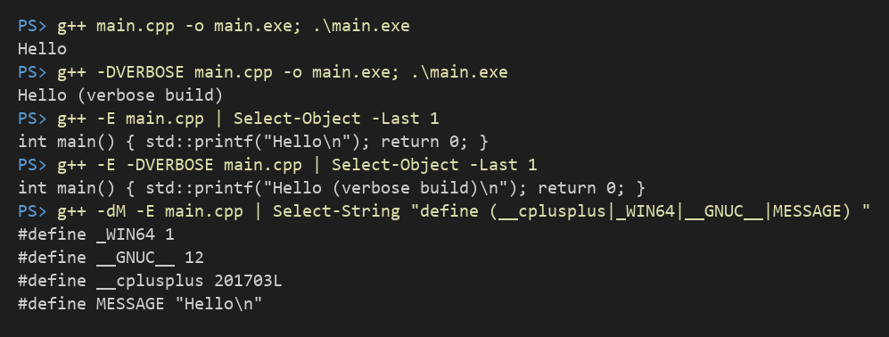
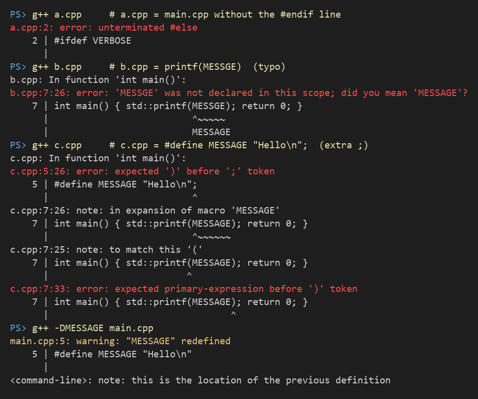

# Step 09 — `#define`, `#ifdef` and `-D`: the preprocessor edits text

## Goal
`#include` **adds** text. Now we see the other two jobs of the preprocessor:
**replace** text (`#define`) and **remove** text (`#ifdef`). And we control it from the command line with `-D`.

## Changes in this commit
- `main.cpp`: 5 lines added, 1 line changed
  ```cpp
  #include <cstdio>
  #ifdef VERBOSE
  #define MESSAGE "Hello (verbose build)\n"
  #else
  #define MESSAGE "Hello\n"
  #endif
  int main() { std::printf(MESSAGE); return 0; }
  ```
- `main.ii`: regenerated. (`main.s` and `main.o` did **not** change — see below.)
- This doc file, 2 images, and one line in the README.

## Concepts
- `#define MESSAGE "Hello\n"` = "from now on, replace the word `MESSAGE` with `"Hello\n"`". Pure **text** replacement,
  done before the compiler runs. The compiler never sees the name `MESSAGE`.
- `#ifdef VERBOSE ... #else ... #endif` = keep one block of lines and **delete** the other, depending on whether
  `VERBOSE` is defined.
- `-DVERBOSE` on the command line = as if `#define VERBOSE` (value `1`) were written at the top of the file.
  This is how one source file builds into different programs (debug/release, Windows/Linux, ...).
- The compiler also **predefines** many macros: `__cplusplus` (C++ version), `_WIN64` (you are on 64-bit Windows),
  `__GNUC__` (the GCC major version). Headers use them to adapt to your platform.

## Do it by hand (PowerShell, in the repo root)

### 1. Two builds from one source
```powershell
g++ main.cpp -o main.exe; .\main.exe
g++ -DVERBOSE main.cpp -o main.exe; .\main.exe
```
Expect: `Hello`, then `Hello (verbose build)`.

### 2. Look at the result of the preprocessor
```powershell
g++ -E main.cpp | Select-Object -Last 1
g++ -E -DVERBOSE main.cpp | Select-Object -Last 1
```
Expect: `MESSAGE` has **disappeared**, replaced by the string. The `#ifdef` lines are gone too:
```
int main() { std::printf("Hello\n"); return 0; }
int main() { std::printf("Hello (verbose build)\n"); return 0; }
```

### 3. List all macros: `-dM -E`
```powershell
g++ -dM -E main.cpp | Select-String "define (__cplusplus|_WIN64|__GNUC__|MESSAGE) "
```
Expect:
```
#define _WIN64 1
#define __GNUC__ 12
#define __cplusplus 201703L     <-- 2017 = C++17, as we saw in Step 02
#define MESSAGE "Hello\n"
```
(`g++ -dM -E main.cpp` alone prints about 1091 macros: yours + the compiler's + all from `<cstdio>`.)



### 4. Macros don't reach the compiler
```powershell
g++ -save-temps main.cpp -o main.exe
git status --short
```
Expect: only `main.cpp` and `main.ii` are modified. `main.s` and `main.o` are **identical** to Step 08,
because after preprocessing the code is exactly the same: `std::printf("Hello\n")`.

## Errors you may hit at this step



| What you do | Message | Meaning |
|---|---|---|
| Forget `#endif` | `error: unterminated #else` (points at the `#ifdef` line) | Preprocessor error: every `#ifdef` needs an `#endif` |
| Typo when using the macro: `printf(MESSGE)` | `error: 'MESSGE' was not declared in this scope; did you mean 'MESSAGE'?` | The preprocessor didn't know `MESSGE`, so it left the word alone. The **compiler** then reports an unknown name |
| `;` at the end of `#define`: `#define MESSAGE "Hello\n";` | `error: expected ')' before ';' token` + `note: in expansion of macro 'MESSAGE'` | The `;` is part of the replacement text → `printf("Hello\n";)`. The error points at the `#define` line, then at **where it was used** |
| Define it twice: `g++ -DMESSAGE main.cpp` | `warning: "MESSAGE" redefined` + `<command-line>: note: this is the location of the previous definition` | `-D` defined `MESSAGE` first, then the file defined it again. `<command-line>` is the "file" for `-D` macros (seen in `main.ii` line 3 in Step 03!) |
| Lowercase `-dVERBOSE` | `cc1plus.exe: warning: unrecognized gcc debugging option: V` (one line per letter) | `-d` (lowercase) is a different option (debug dumps). The macro is **not** defined → prints `Hello` |
| `-Dverbose` (lowercase name) | (no error) prints `Hello` | Macro names are case-sensitive: `verbose` ≠ `VERBOSE` |

👉 Next step: our own header file — `"..."` vs `<...>`, and telling g++ where to look with `-I`.
