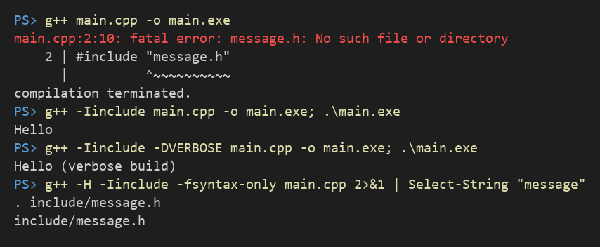
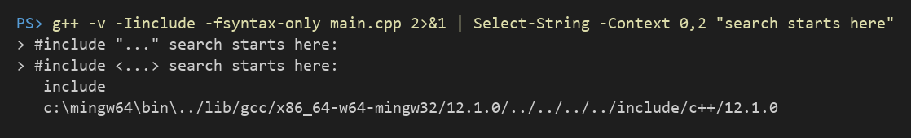
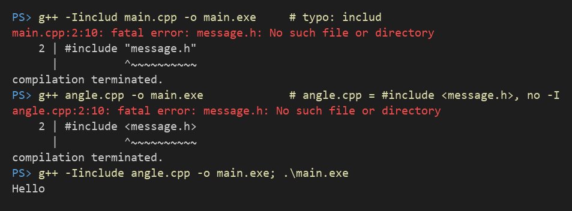

# Step 10 — Your own header: `"..."` vs `<...>`, and `-I`

## Goal
Move our macros into **our own header file** in an `include/` folder, and learn how g++ **finds** header files.

## Changes in this commit
- New file `include/message.h`: the 5 `#ifdef`/`#define` lines, moved out of `main.cpp`.
- `main.cpp`: those 5 lines replaced by 1 line: `#include "message.h"`
  ```cpp
  #include <cstdio>
  #include "message.h"
  int main() { std::printf(MESSAGE); return 0; }
  ```
- `main.ii`: regenerated (`main.s`/`main.o` unchanged again — the code after preprocessing is the same).
- This doc file, 3 images, and one line in the README.

## Concepts
How g++ searches for a header:

| You write | Search order |
|---|---|
| `#include "message.h"` | 1. the folder of the **file that contains the `#include`** (here: the repo root) → 2. folders from `-I` → 3. system folders |
| `#include <message.h>` | 1. folders from `-I` → 2. system folders. (Never the current file's folder.) |

- `-I<dir>` adds a folder to the search list, **before** the system folders.
- Convention: `"..."` for your project's headers, `<...>` for system / third-party libraries.
- The header file is **not compiled on its own**. It only exists to be copied into `.cpp` files by `#include`.
  You never pass `.h` files to `g++` on the command line.

## Do it by hand (PowerShell, in the repo root)

### 1. Without and with `-I`
```powershell
g++ main.cpp -o main.exe
g++ -Iinclude main.cpp -o main.exe; .\main.exe
g++ -Iinclude -DVERBOSE main.cpp -o main.exe; .\main.exe
g++ -H -Iinclude -fsyntax-only main.cpp 2>&1 | Select-String "message"
```
Expect:
- First command: `fatal error: message.h: No such file or directory` — `message.h` is not next to `main.cpp`, and g++ doesn't know about `include/`.
- With `-Iinclude`: `Hello`. With `-DVERBOSE` too: `Hello (verbose build)` — `-D` still works through the header.
- `-H` shows `. include/message.h` (one dot = included directly by `main.cpp`), and at the very end
  `include/message.h` appears again under the line `Multiple include guards may be useful for:` — keep this in mind for Step 13.



### 2. See the search list
```powershell
g++ -v -Iinclude -fsyntax-only main.cpp 2>&1 | Select-String -Context 0,2 "search starts here"
```
Expect: `include` is now the **first** folder in the `#include <...>` list, before the system folders:
```
> #include "..." search starts here:
> #include <...> search starts here:
   include
   c:\mingw64\bin\../lib/gcc/x86_64-w64-mingw32/12.1.0/../../../../include/c++/12.1.0
```
(The `"..."` list is empty: "the current file's folder" is always searched first and is not printed.)



## Errors you may hit at this step



| What you do | Message | Meaning |
|---|---|---|
| Forget `-Iinclude` | `fatal error: message.h: No such file or directory` | The header isn't in any folder g++ searches |
| Typo in the folder: `-Iinclud` | **Same** error, no hint about the folder | ⚠ g++ does **not** warn when an `-I` folder doesn't exist. Check the path yourself |
| `#include <message.h>` without `-I`, with `message.h` **next to** `main.cpp` | `fatal error: message.h: No such file or directory` | `<...>` never searches the current file's folder. `"..."` would have found it |
| `#include <message.h>` **with** `-Iinclude` | (works) | `-I` folders are searched for both forms |
| Pass the header to g++: `g++ -Iinclude main.cpp include\message.h` | Creates `include\message.h.gch` (a "precompiled header") instead of an error | Headers are not compiled by themselves. Delete the `.gch` file and don't list `.h` files in the command |

> 💡 From now on, every build command in this repo needs `-Iinclude`.
> Real projects have many `-I` flags — one reason why build tools (Step 18–20) exist.

👉 Next step: a second `.cpp` file — **separate compilation**: compile each file alone, link them together.
