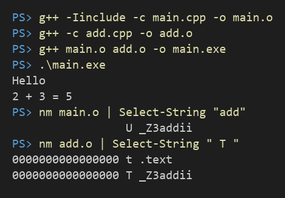
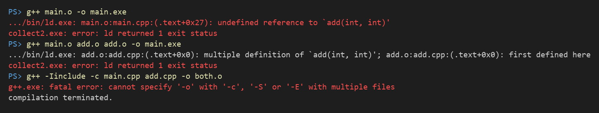
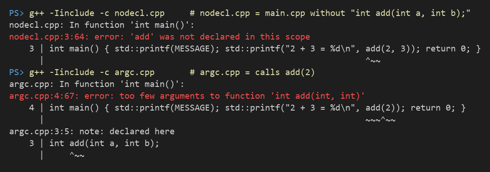

# Step 11 — A second `.cpp` file: separate compilation

## Goal
Real programs have many `.cpp` files. Each one is compiled **alone** into its own `.o`, and the linker joins them.
This is where the split between **compile** and **link** (Steps 04–07) really pays off.

## Changes in this commit
- New file `add.cpp` (1 line):
  ```cpp
  int add(int a, int b) { return a + b; }
  ```
- `main.cpp`: 1 line added (a **declaration**), 1 line changed (call `add`):
  ```cpp
  int add(int a, int b);
  int main() { std::printf(MESSAGE); std::printf("2 + 3 = %d\n", add(2, 3)); return 0; }
  ```
- `main.ii`, `main.s`, `main.o` regenerated; new `add.o`.
- This doc file, 3 images, and one line in the README.

## Concepts
- **Declaration** `int add(int a, int b);` = a promise: "a function `add` exists somewhere, it takes 2 `int` and returns `int`".
  It is enough for the **compiler** to check and compile the call.
- **Definition** `int add(int a, int b) { return a + b; }` = the actual code. It must exist **exactly once** in the whole program.
- Each `.cpp` file (after preprocessing) is one **translation unit**. The compiler sees **one at a time**:
  while compiling `main.cpp`, it knows nothing about `add.cpp`.

```
main.cpp ──g++ -c──▶ main.o   (T main, U add)  ─┐
                                                ├──ld──▶ main.exe
add.cpp  ──g++ -c──▶ add.o    (T add)          ─┘
```

- Why bother? If you change only `add.cpp`, you only re-compile `add.cpp` and re-link. In big projects
  (thousands of files) this saves minutes or hours. (Step 18 uses this.)

## Do it by hand (PowerShell, in the repo root)

### 1. Compile each file, then link
```powershell
g++ -Iinclude -c main.cpp -o main.o
g++ -c add.cpp -o add.o
g++ main.o add.o -o main.exe
.\main.exe
nm main.o | Select-String "add"
nm add.o | Select-String " T "
```
Expect:
```
Hello
2 + 3 = 5
                 U _Z3addii          <-- main.o NEEDS add
0000000000000000 T _Z3addii          <-- add.o HAS add
```
`add.cpp` doesn't include anything, so it doesn't need `-Iinclude`.
`_Z3addii` is the "mangled" name of `add(int, int)` — Step 14.



### 2. Or in one command
```powershell
g++ -Iinclude main.cpp add.cpp -o main.exe
```
Same result: g++ compiles each `.cpp` into a **temporary** `.o` (as in Step 02) and links them. Nothing is kept,
so everything is re-compiled every time.

## Errors you may hit at this step



| What you do | Message | Meaning |
|---|---|---|
| Link without `add.o`: `g++ main.o -o main.exe` | `undefined reference to 'add(int, int)'` + `ld returned 1 exit status` | **Link** error: the declaration promised `add`, but no `.o` defines it. Same with `g++ -Iinclude main.cpp -o main.exe` (only one `.cpp`) |
| Give the same object twice: `g++ main.o add.o add.o` | `multiple definition of 'add(int, int)'; ... first defined here` | **Link** error: the definition must exist exactly once. (The usual cause in real code: a definition inside a header — Step 13) |
| `g++ -c main.cpp add.cpp -o both.o` | `fatal error: cannot specify '-o' with '-c', '-S' or '-E' with multiple files` | `-c` makes **one `.o` per `.cpp`**; it cannot merge them. Drop `-o` (you get `main.o` and `add.o`) or compile one by one |



| What you do | Message | Meaning |
|---|---|---|
| Remove the declaration `int add(int a, int b);` | `error: 'add' was not declared in this scope` | **Compile** error: the compiler sees one file at a time; it can't look into `add.cpp` |
| Call with the wrong arguments: `add(2)` | `error: too few arguments to function 'int add(int, int)'` + `note: declared here` | The declaration lets the compiler **check every call**. That is its whole purpose |

> 💡 Compare the two `undefined` errors:
> **compile** error = `'add' was not declared` (no declaration) vs **link** error = `undefined reference to 'add(int, int)'` (no definition).

👉 Next step: copying the declaration into every file that uses `add` doesn't scale — put it in a **header**.
