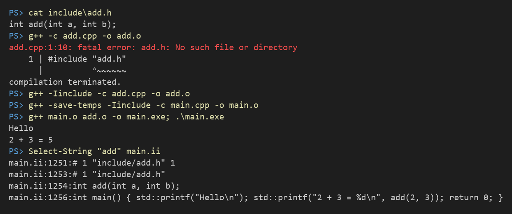
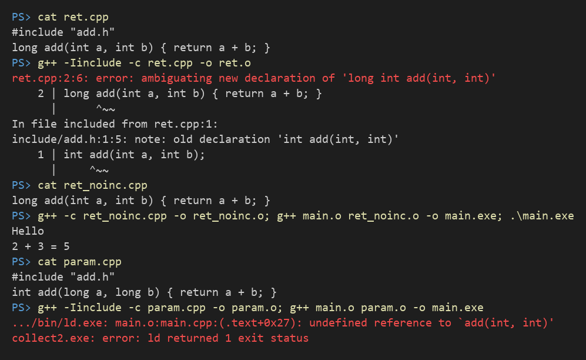

# Step 12 — Put the declaration in a header: `add.h`

## Goal
In Step 11 we typed the declaration `int add(int a, int b);` by hand in `main.cpp`.
With 50 files using `add`, that's 50 copies to keep in sync. Instead we write it **once** in a header and `#include` it.

## Changes in this commit
- New file `include/add.h` (1 line): `int add(int a, int b);`
- `main.cpp`: the declaration line replaced by `#include "add.h"`
- `add.cpp`: 1 line added at the top: `#include "add.h"` (see "why" below)
- `main.ii` regenerated. `main.s`, `main.o`, `add.o` are **unchanged** — the compiled code is identical to Step 11.
- This doc file, 2 images, and one line in the README.

## Concepts
- A header is just a way to **share declarations** between translation units. After preprocessing,
  `main.cpp` contains exactly the same line as in Step 11 (`int add(int a, int b);`) — check `main.ii`.
- **Why does `add.cpp` include its own header?** So the compiler can compare the **declaration** (that every other
  file trusts) with the **definition** (the real code). If they disagree, you get a compile error instead of a silent bug.
- Rule of thumb: `X.h` declares, `X.cpp` defines and **includes `X.h` first**.

## Do it by hand (PowerShell, in the repo root)

```powershell
cat include\add.h
g++ -c add.cpp -o add.o
g++ -Iinclude -c add.cpp -o add.o
g++ -save-temps -Iinclude -c main.cpp -o main.o
g++ main.o add.o -o main.exe; .\main.exe
Select-String "add" main.ii
```
Expect:
- `g++ -c add.cpp` → `fatal error: add.h: No such file or directory`: `add.cpp` now needs `-Iinclude` too.
- With `-Iinclude`: no output, then `Hello` / `2 + 3 = 5`.
- In `main.ii`, the line `int add(int a, int b);` appears, after the line marker `# 1 "include/add.h"` —
  the header was copied in, exactly like Step 08.
- `git status`: `main.s`, `main.o`, `add.o` not modified.



## Experiment: what if declaration and definition disagree?



| `add.cpp` contains | Result | Why |
|---|---|---|
| `#include "add.h"` + `long add(int a, int b) {...}` (return type differs) | **Compile error**: `ambiguating new declaration of 'long int add(int, int)'` + `note: old declaration 'int add(int, int)'` | The compiler sees both lines in the same translation unit and compares them. ✅ This is why we include our own header |
| **No** `#include` + `long add(int a, int b) {...}` | ⚠ **No error at all.** Compiles, links, runs | The linker only matches **names**. The return type is not part of the name `_Z3addii`, so `main.o` and the wrong `add.o` link fine. This is **undefined behavior**: it happens to work here, but could return garbage |
| `#include "add.h"` + `int add(long a, long b) {...}` (parameters differ) | Compiles (it's a new **overload**), then **link error**: `undefined reference to 'add(int, int)'` | Different parameters = a different function, named `_Z3addll` (`l` = long). Nobody defines `_Z3addii` |

## Errors you may hit at this step

| What you do | Message | Meaning |
|---|---|---|
| Compile `add.cpp` without `-Iinclude` | `fatal error: add.h: No such file or directory` | `add.cpp` is in the root, `add.h` is in `include/`. Every file that includes it needs `-Iinclude` |
| Forget the `;` at the end of `int add(int a, int b)` in `add.h` | `main.cpp:4:1: error: expected initializer before 'int'` — reported in **`main.cpp`**, not in `add.h`! | The header is pasted into `main.cpp`; the compiler only notices the missing `;` at the next token, which is `int main()` on line 4. When an error makes no sense, look at the end of the **previous** `#include` |
| Put the **definition** `{ return a + b; }` in `add.h` | `multiple definition of 'add(int, int)'` at link time | Every `.cpp` that includes the header gets its own copy of the code. Next step |

👉 Next step: what may and may not go into a header — **multiple definition**, `inline`, and **include guards** (`#pragma once`).
