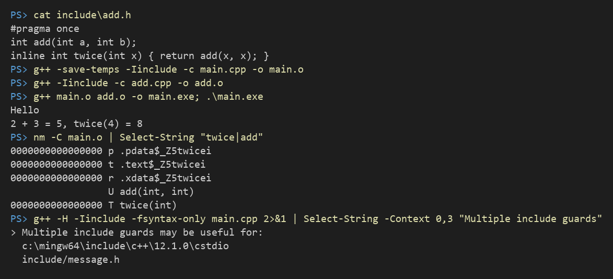
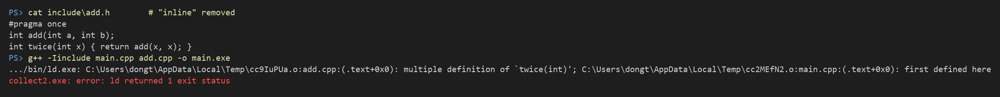
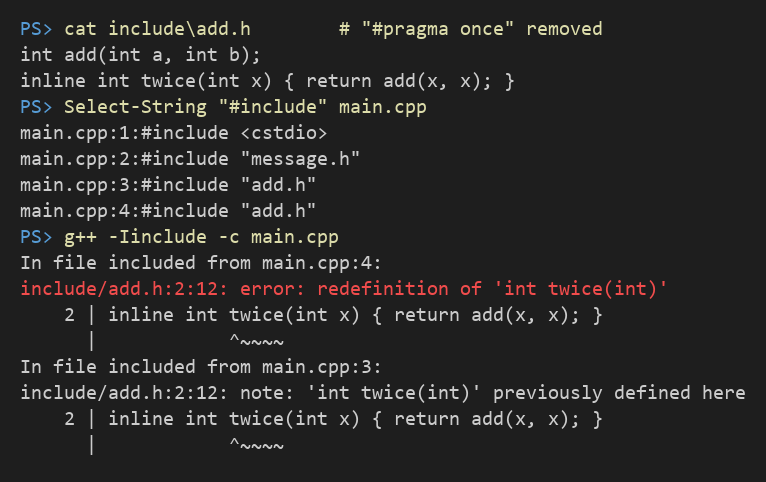

# Step 13 — What can go in a header: ODR, `inline`, and `#pragma once`

## Goal
Step 12 hinted that putting a **definition** in a header causes `multiple definition`.
Here we add a small function **with its body** to `add.h` — correctly — and see the two mechanisms that make it safe:
`inline` (for the linker) and `#pragma once` (for the preprocessor).

## Changes in this commit
- `include/add.h`: 2 lines added
  ```cpp
  #pragma once
  int add(int a, int b);
  inline int twice(int x) { return add(x, x); }
  ```
- `main.cpp`: the second `printf` also prints `twice(4)`.
- `main.ii`, `main.s`, `main.o` regenerated.
- This doc file, 3 images, and one line in the README.

## Concepts
### ODR — the One Definition Rule
- A normal (non-inline) function must be **defined exactly once in the whole program**.
- A header is copied into **every** `.cpp` that includes it. `add.h` is included by `main.cpp` **and** `add.cpp`
  → a normal function defined in it would exist in `main.o` **and** `add.o` → `multiple definition` at link time.
- **Declarations** may be repeated as often as you like: `int add(int a, int b);` twice is fine.

### `inline` — "many identical copies are OK, linker: keep one"
- `inline` allows the same definition in many translation units (they must be identical).
- The compiler puts each copy in its own special section (`.text$_Z5twicei` — see `nm` below). The linker sees
  several sections with that name and **keeps only one**, instead of reporting an error.
- (`inline` today means "may be defined in many files", not "please inline the code".)

### `#pragma once` — "copy this header only once per translation unit"
- Different problem: if one `.cpp` includes the same header **twice** (directly, or through other headers),
  the definition of `twice` appears twice **in the same file** → compile error `redefinition`.
- `#pragma once` tells the preprocessor: "if this file was already included in this translation unit, skip it".
- The classic, portable equivalent is an **include guard**:
  ```cpp
  #ifndef ADD_H
  #define ADD_H
  ...
  #endif
  ```

| Problem | Where | Fixed by |
|---|---|---|
| Same definition in **two `.cpp` files** | Linker: `multiple definition` | `inline` (or move the body into a `.cpp`) |
| Same header included **twice in one `.cpp`** | Compiler: `redefinition` | `#pragma once` / include guard |

## Do it by hand (PowerShell, in the repo root)

```powershell
cat include\add.h
g++ -save-temps -Iinclude -c main.cpp -o main.o
g++ -Iinclude -c add.cpp -o add.o
g++ main.o add.o -o main.exe; .\main.exe
nm -C main.o | Select-String "twice|add"
g++ -H -Iinclude -fsyntax-only main.cpp 2>&1 | Select-String -Context 0,3 "Multiple include guards"
```
Expect:
- `Hello` / `2 + 3 = 5, twice(4) = 8`
- `nm -C` (`-C` = show readable names): `T twice(int)` inside a section named `.text$_Z5twicei` — the inline copy.
  `add.o` has no `twice`: `add.cpp` includes the header but never calls `twice`, so no copy is made.
- The `-H` list "Multiple include guards may be useful for:" now shows `cstdio` and `message.h`,
  but **not `add.h` any more** — it has `#pragma once`. (`message.h` would need one too, but it only has macros.)



## Experiment 1: remove `inline`



`multiple definition of 'twice(int)'`: `add.cpp:(.text+0x0)` and `main.cpp:(.text+0x0)` both contain the function.
Without `inline`, the body is placed in the plain `.text` section of **every** object file that includes the header,
even if that file never calls it.

## Experiment 2: remove `#pragma once` and include `add.h` twice



`redefinition of 'int twice(int)'` — the error shows the **include chain**: `In file included from main.cpp:4`
(second copy) and `In file included from main.cpp:3` (`previously defined here`). Declarations alone would not complain;
only the definition does.

## Errors you may hit at this step

| What you do | Message | Meaning |
|---|---|---|
| Function body in a header, no `inline` | `multiple definition of 'twice(int)'; ... first defined here` | **Link** error. ODR violation across translation units |
| Header included twice, no guard | `error: redefinition of 'int twice(int)'` + `previously defined here` | **Compile** error. ODR violation inside one translation unit |
| `#ifndef ADD_H` guard but forget `#define ADD_H` | `redefinition` again | The guard never "closes", so the second include is not skipped |
| `#ifndef` guard but forget `#endif` | `error: unterminated #ifndef` | Same as Step 09 |
| Two different headers both use `#ifndef UTIL_H` | Strange `'x' was not declared in this scope` errors | The second header is silently skipped because the guard name is already defined. `#pragma once` avoids this |

👉 Next step: what are these strange names like `_Z5twicei` and `_Z3addii`? **Name mangling** and `extern "C"`.
