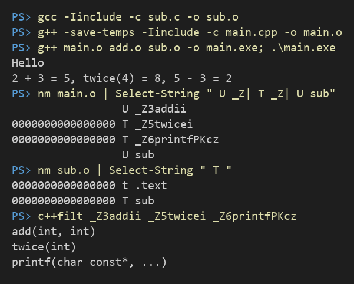
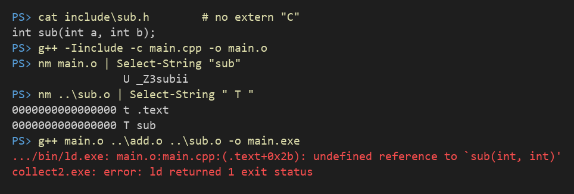
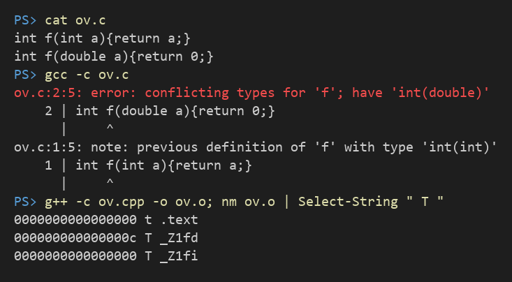

# Step 14 — Name mangling and `extern "C"`: linking C with C++

## Goal
Since Step 08 we have seen strange names like `_Z3addii` and `_Z6printfPKcz`. They are **mangled names**.
In this step we explain them, then add a **C** file to the project and see why C++ needs `extern "C"` to call it.

## Changes in this commit
- New file `sub.c` (C, not C++):
  ```c
  #include "sub.h"
  int sub(int a, int b) { return a - b; }
  ```
- New file `include/sub.h`: the declaration of `sub`, wrapped in `extern "C"` for C++ only:
  ```cpp
  #pragma once
  #ifdef __cplusplus
  extern "C" {
  #endif
  int sub(int a, int b);
  #ifdef __cplusplus
  }
  #endif
  ```
- `main.cpp`: `#include "sub.h"` and also prints `sub(5, 3)`.
- `main.ii`, `main.s`, `main.o` regenerated; new `sub.o`.
- This doc file, 3 images, and one line in the README.

## Concepts
### Why mangling?
C++ allows **overloading**: `f(int)` and `f(double)` are two different functions with the same name.
But the linker only matches **plain names** (Step 06). So the C++ compiler **encodes the parameter types into the name**:

```
_Z 3add i i     →  add(int, int)
│  │└┬┘ └┬┘
│  │ │   └─ parameter types: i = int, d = double, l = long, PKc = pointer to const char, z = "..."
│  │ └─ the name
│  └─ length of the name
└─ "this is a mangled C++ name"
```
- C has **no overloading**, so C does **not** mangle: `sub` stays `sub`.
- The return type is **not** in the name (that's why Step 12's wrong return type linked silently).

### `extern "C"`
- `extern "C"` tells the **C++ compiler**: "this function follows C rules — use the plain name `sub`, don't mangle".
- `#ifdef __cplusplus` (a predefined macro, Step 09) hides `extern "C"` from the C compiler, which doesn't understand it.
  So the **same header** works for both `sub.c` (C) and `main.cpp` (C++).

### `gcc` vs `g++`
- Both are drivers for the same compiler collection. They pick the language from the **file extension**:
  `.c` → C (`cc1.exe`), `.cpp` → C++ (`cc1plus.exe`).
- Differences: `g++` compiles `.c` files **as C++** too, and `g++` links the C++ standard library (`-lstdc++`) automatically.

## Do it by hand (PowerShell, in the repo root)

```powershell
gcc -Iinclude -c sub.c -o sub.o
g++ -save-temps -Iinclude -c main.cpp -o main.o
g++ main.o add.o sub.o -o main.exe; .\main.exe
nm main.o | Select-String " U _Z| T _Z| U sub"
nm sub.o | Select-String " T "
c++filt _Z3addii _Z5twicei _Z6printfPKcz
```
Expect:
- `Hello` / `2 + 3 = 5, twice(4) = 8, 5 - 3 = 2`
- `main.o` needs `U _Z3addii` (C++ function, mangled) and `U sub` (extern "C", plain).
- `sub.o` has `T sub` — plain. The names match → link OK.
- `c++filt` (the "demangler") translates: `add(int, int)`, `twice(int)`, `printf(char const*, ...)`.
  `nm -C` does the same (Step 13), and `ld` demangles in its error messages.



## Experiment 1: forget `extern "C"`



With a plain `int sub(int a, int b);` in the header, `main.cpp` asks for **`_Z3subii`**, but `sub.o` (compiled as C) only has **`sub`**
→ `undefined reference to 'sub(int, int)'`. Notice the linker shows the **demangled** name — so the message looks
like the function is simply missing, while in fact it's there under a different name. **Classic C/C++ mixing bug.**

## Experiment 2: overloading in C vs C++



The same two functions `f(int)` and `f(double)`: C refuses (`conflicting types for 'f'`), C++ accepts and makes
two symbols `_Z1fi` and `_Z1fd`.

## Errors you may hit at this step

| What you do | Message | Meaning |
|---|---|---|
| C function declared in C++ without `extern "C"` | `undefined reference to 'sub(int, int)'` | C++ looks for `_Z3subii`, C defined `sub`. Check with `nm` |
| `extern "C"` in a header included by a `.c` file, without `#ifdef __cplusplus` | `error: expected identifier or '(' before string constant` | `extern "C"` is C++ syntax; the C compiler doesn't know it |
| Overloads in C | `error: conflicting types for 'f'` | C has one name = one function |
| Compile `sub.c` with `g++` and a header **without** `extern "C"` | No error, but `sub.o` contains `_Z3subii` | `g++` treats `.c` as C++. Use `gcc` for C files (or keep `extern "C"`) |
| `nm` output too cryptic | — | Use `nm -C` or pipe through `c++filt` |

👉 Next step: package `add.o` and `sub.o` into a **static library** (`.a`) with `ar`.
