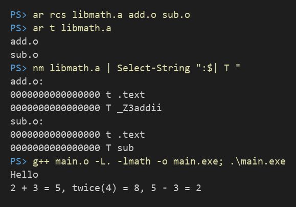
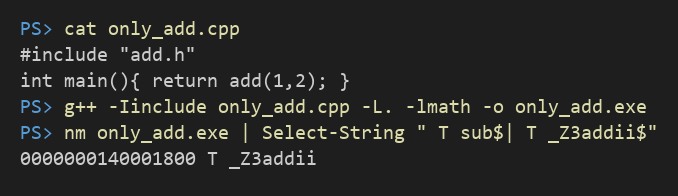
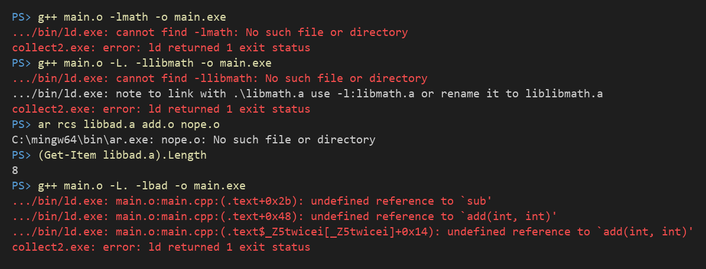

# Step 15 — Static library: pack `.o` files into `libmath.a` with `ar`

## Goal
`add.o` and `sub.o` are reusable "math" code. Instead of passing every `.o` to the linker, we pack them into
**one library file** — the same kind of file as `libgcc.a` and `libmingw32.a` from Steps 06–07.

## Changes in this commit
- **No source changes.**
- New generated file `libmath.a` (tracked, like the other intermediate files).
- This doc file, 3 images, and one line in the README.

## Concepts
- A **static library** (`.a` on MinGW/Linux, `.lib` on MSVC) is just an **archive** of `.o` files + an index of their
  symbols. Think "a `.zip` of object files", without compression.
- `ar` = the **archiver** (binutils, like `as`, `ld`, `nm`). Flags in `ar rcs`:
  `r` = insert/replace members, `c` = create the archive if needed (no warning), `s` = write the symbol index.
- When linking, `ld` takes **only the members it needs** — those that define a symbol still undefined at that moment.
  The chosen `.o` is **copied into the `.exe`**. After linking, the `.exe` doesn't need the `.a` any more.
- `-lmath` = search for `libmath.a` (Step 06 rule: `lib` + name + `.a`), in the `-L` folders.

```
add.o ─┐                        main.o ──┐
       ├─ ar rcs ─▶ libmath.a ───────────┴─ ld ─▶ main.exe   (contains a copy of add.o and sub.o)
sub.o ─┘
```

## Do it by hand (PowerShell, in the repo root)

### 1. Create, inspect, link
```powershell
ar rcs libmath.a add.o sub.o
ar t libmath.a
nm libmath.a | Select-String ":$| T "
g++ main.o -L. -lmath -o main.exe; .\main.exe
```
Expect:
- `ar` prints nothing.
- `ar t` (= table of contents): `add.o`, `sub.o`.
- `nm` on an archive lists the symbols **per member**: `add.o: T _Z3addii`, `sub.o: T sub`.
- `-L.` = "look in the current folder"; the program prints the same 3 lines as Step 14.



You can also give the archive file directly: `g++ main.o libmath.a -o main.exe` (no `-L`/`-l` needed).
And unpack it: `mkdir ex; cd ex; ar x ..\libmath.a` gives back `add.o` and `sub.o`.

### 2. Only what is needed gets linked
A test program that only calls `add`:
```cpp
#include "add.h"
int main(){ return add(1,2); }
```
```powershell
g++ -Iinclude only_add.cpp -L. -lmath -o only_add.exe
nm only_add.exe | Select-String " T sub$| T _Z3addii$"
```
Expect: only `T _Z3addii` — **no `sub`**. `ld` never pulled `sub.o` out of the library.
(If you had passed `add.o sub.o` directly, both would be in the `.exe`, used or not.)



## Errors you may hit at this step



| What you do | Message | Meaning |
|---|---|---|
| `g++ main.o -lmath` (no `-L.`) | `cannot find -lmath: No such file or directory` | `ld` doesn't search the current folder by default |
| `-llibmath` | `cannot find -llibmath` + `note to link with .\libmath.a use -l:libmath.a ...` | Don't write the `lib` prefix: `-lmath` |
| `ar rcs libbad.a add.o nope.o` (a missing file) | `ar.exe: nope.o: No such file or directory` — and **an empty 8-byte `libbad.a` is left behind** | ⚠ Linking with it later gives `undefined reference` to **everything**, which looks like a code problem. Check with `ar t` |
| Change `add.cpp`, recompile `add.o`, forget to re-run `ar` | Old behavior, no error | The `.a` contains a **copy** of the old `add.o`. Rebuild the library after every change (build tools do it for you — Step 18–20) |
| `ar rcs libsrc.a add.cpp` (a source file, not an object) | No error from `ar`; linking with it fails: `libsrc.a: error adding symbols: archive has no index; run ranlib to add one` | `ar` stores any file, but finds no symbols in a `.cpp`, so it writes no index. Only `.o` files belong in a library |

👉 Next step: **link order** — `g++ -L. -lmath main.o` fails, while `g++ main.o -L. -lmath` works. Why?
