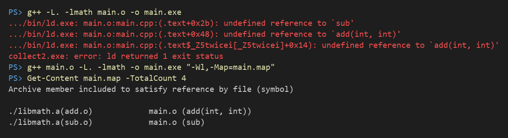
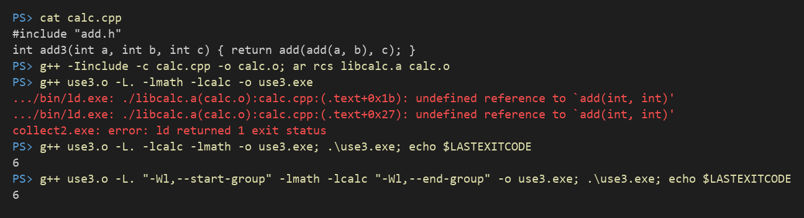

# Step 16 — Link order: why `-lmath main.o` fails

## Goal
`g++ main.o -L. -lmath` works, but `g++ -L. -lmath main.o` fails with `undefined reference`, although
it's the **same files**. This step explains how `ld` reads its inputs, and how to see what it takes from a library.

## Changes in this commit
- **No code changes.**
- This doc file, 2 images, and one line in the README.

## Concepts
`ld` processes the command line **once, from left to right**, keeping a list of **still-undefined symbols**:

| Input type | What `ld` does |
|---|---|
| `.o` file | **Always** linked completely. Its `U` symbols are added to the "undefined" list, its `T` symbols resolve entries |
| `.a` library | Looks **only at the current "undefined" list**. Takes the members that define something on it. Then **moves on and never comes back** |

So in `g++ -L. -lmath main.o`:
1. `libmath.a` is reached first. The undefined list is (almost) empty → nothing taken.
2. `main.o` arrives and needs `add` and `sub` → but `libmath.a` is already behind us → `undefined reference`.

**Rule: a library must come after everything that uses it.** Objects first, then libraries, and a library that
depends on another library comes **before** it. That's why `g++` puts `-lstdc++ -lmingw32 ... -lkernel32` at the very end (Step 02).

`-Wl,<option>` passes an option from `g++` **to `ld`**. `-Wl,-Map=main.map` asks `ld` to write a "map file" that explains
every decision.

## Do it by hand (PowerShell, in the repo root)

### 1. Wrong order, right order, and the map file
```powershell
g++ -L. -lmath main.o -o main.exe
g++ main.o -L. -lmath -o main.exe "-Wl,-Map=main.map"
Get-Content main.map -TotalCount 4
```
Expect:
- First command: 3 × `undefined reference` (`sub`, `add(int, int)` twice) — although `libmath.a` contains both.
- Second command: no output (success).
- The map file starts with **why each archive member was taken**:
  ```
  Archive member included to satisfy reference by file (symbol)

  ./libmath.a(add.o)            main.o (add(int, int))
  ./libmath.a(sub.o)            main.o (sub)
  ```
  → "`add.o` was pulled out of `libmath.a` because `main.o` needed `add(int, int)`".
  Scroll further in `main.map`: you'll also see `libmingw32.a(...gccmain.o)` pulled in by `crt2.o (__main)` — Step 07's chain.

⚠ In PowerShell, write `"-Wl,-Map=main.map"` **in quotes**: a comma means "array" in PowerShell.



### 2. A library that needs another library
Imagine `libcalc.a` with a function `add3` that calls `add` from `libmath.a`:
```cpp
#include "add.h"
int add3(int a, int b, int c) { return add(add(a, b), c); }
```
And a program `use3.o` that calls `add3`. (This demo uses temporary files, they are not committed.)

| Command | Result |
|---|---|
| `g++ use3.o -L. -lmath -lcalc` | ❌ `libcalc.a(calc.o): undefined reference to 'add(int, int)'` — `calc.o` was taken **after** `libmath.a` was passed |
| `g++ use3.o -L. -lcalc -lmath` | ✅ exit code `6` (1 + 2 + 3) |
| `g++ use3.o -L. "-Wl,--start-group" -lmath -lcalc "-Wl,--end-group"` | ✅ `ld` loops over the group until nothing new is found. Useful for libraries that need **each other** (circular), but slower |



Note the error message names the culprit: `./libcalc.a(calc.o)` — the undefined reference comes from **inside** a library,
not from your code.

## Errors you may hit at this step

| What you do | Message | Meaning |
|---|---|---|
| Library before the objects: `g++ -L. -lmath main.o` | `undefined reference to 'sub'`, `'add(int, int)'` | Order. Move `-lmath` to the end |
| Two libraries in the wrong order | `./libcalc.a(calc.o): ... undefined reference to 'add(int, int)'` | The library that **uses** must come before the library that **defines** |
| `-Wl,-Map=main.map` without quotes in PowerShell | `Missing argument in parameter list.` (PowerShell parser error — g++ never runs) | Put the whole `-Wl,...` argument in quotes |
| `"-Wl," "-Map=main.map"` (space after the comma) | `g++.exe: error: unrecognized command-line option '-Map=main.map'` | `-Map=...` became a separate argument, read by **g++** (which doesn't know it), not by `ld`. `-Wl,...` must be one word |
| A failed link | The old `main.exe` is **deleted** | Like `as` in Step 05: on error, the output file is removed. A stale exe can't fool you |

> 💡 Order only matters for **libraries** (`.a`). Plain `.o` files are always fully linked, in any order.

👉 Next step: the other kind of library — a **DLL** (dynamic library), loaded when the program **starts**, not when it is linked.
