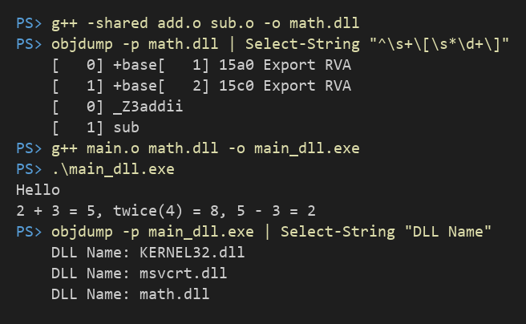
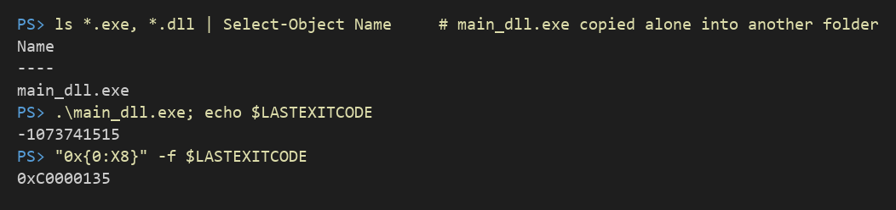

# Step 17 — Dynamic library: `math.dll`

## Goal
With a static library (Step 15), the code of `add`/`sub` is **copied into** `main.exe` at link time.
With a **dynamic library** (DLL on Windows, `.so` on Linux) the code stays in a separate file and is loaded by
Windows **when the program starts**. We build `math.dll`, link against it, and break it.

## Changes in this commit
- **No source changes.**
- New generated file `math.dll` (tracked).
- This doc file, 2 images, and one line in the README.

## Concepts

| | Static `libmath.a` | Dynamic `math.dll` |
|---|---|---|
| When is `add` joined to the program? | **Link time** (by `ld`) | **Load time** (by the Windows loader, when `main.exe` starts) |
| Where is the code of `add`? | Inside `main.exe` | Inside `math.dll`; `main.exe` only has a small "jump" stub |
| Needed to **run** `main.exe`? | No | **Yes** — `math.dll` must be found at start-up |
| Update `add` without relinking `main.exe`? | No | Yes: replace the DLL (if the functions keep the same names/signatures) |

- `g++ -shared` = link a **DLL** instead of an `.exe`. MinGW exports all functions by default; the **export table**
  lists them (`_Z3addii`, `sub`).
- The `.exe` gets an **import table**: "I need `math.dll`, and from it `_Z3addii` and `sub`". You already depend on DLLs
  without knowing it: `KERNEL32.dll` and `msvcrt.dll` (that is what `-lkernel32` and `-lmsvcrt` did in Step 07).
- MinGW `ld` can link **directly** against a `.dll` (`g++ main.o math.dll`). The classic way is an **import library**
  (`libmath.dll.a`, MSVC: `math.lib`) made with `"-Wl,--out-implib,libmath.dll.a"` — we skip it here on purpose (see the errors table).
- Where Windows looks for a DLL at start-up (simplified): **the folder of the `.exe`** → system folders (`C:\Windows\System32`) → folders in **`PATH`**.

## Do it by hand (PowerShell, in the repo root)

### 1. Build the DLL and a program that uses it
```powershell
g++ -shared add.o sub.o -o math.dll
objdump -p math.dll | Select-String "^\s+\[\s*\d+\]"
g++ main.o math.dll -o main_dll.exe
.\main_dll.exe
objdump -p main_dll.exe | Select-String "DLL Name"
```
Expect:
- The export table of `math.dll`: `[0] _Z3addii`, `[1] sub` (the mangled C++ name and the plain C name — Step 14).
- `main_dll.exe` prints the same 3 lines as before.
- The import table of `main_dll.exe`: `KERNEL32.dll`, `msvcrt.dll`, **`math.dll`**.



### 2. Run it without the DLL
Copy `main_dll.exe` alone into another folder and run it there:
```powershell
mkdir ..\dll_test; copy main_dll.exe ..\dll_test\; cd ..\dll_test
.\main_dll.exe; echo $LASTEXITCODE
"0x{0:X8}" -f $LASTEXITCODE
cd ..\CppBuildProcess; rmdir ..\dll_test -Recurse
```
Expect:
- Windows shows a **dialog box**: *"The code execution cannot proceed because math.dll was not found. Reinstalling the program may fix this problem."* Click OK.
- The exit code is `-1073741515` = **`0xC0000135`** = `STATUS_DLL_NOT_FOUND`. `main()` never ran — not even `Hello`.



(The screenshot was taken with error dialogs disabled, so only the exit code is visible. From Git Bash the same error is printed as
`error while loading shared libraries: math.dll: cannot open shared object file: No such file or directory`.)

## Errors you may hit at this step

| What you do | Message | Meaning |
|---|---|---|
| Run the `.exe` without its DLL next to it (or in `PATH`) | Dialog *"...math.dll was not found"*; exit code `0xC0000135` | **Load-time** error — a new kind! Build and link were fine |
| Run any MinGW C++ program (e.g. using `std::cout`) on another PC | Dialog *"...libstdc++-6.dll was not found"* (or `libgcc_s_seh-1.dll`, `libwinpthread-1.dll`) | These DLLs live in `C:\mingw64\bin`, which is in **your** `PATH`, not on other machines. Copy them next to the exe, or link with `-static` |
| Both `libmath.dll.a` (import lib) and `libmath.a` exist, `g++ main.o -L. -lmath` | No error — but the exe now **needs `math.dll`** | On MinGW, `-lmath` prefers `libmath.dll.a` over `libmath.a`. Force static with `-l:libmath.a` or `-static` |
| `"-Wl,--out-implib,libmath.dll.a"` without quotes in PowerShell | `Missing argument in parameter list.` | The comma problem from Step 16 |
| Replace `math.dll` with one built from `sub.o` only (no `add`) | Dialog *"The procedure entry point ... could not be located in the dynamic link library ..."*; exit code **`0xC0000139`** (`STATUS_ENTRYPOINT_NOT_FOUND`) | The DLL is found, but a function listed in the exe's import table isn't in the DLL's export table |

👉 Next step: typing all these commands by hand is getting long — write a **build script** and see why rebuilding
only what changed is hard.
