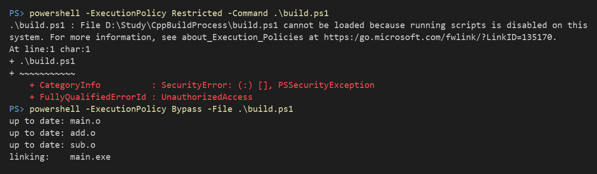
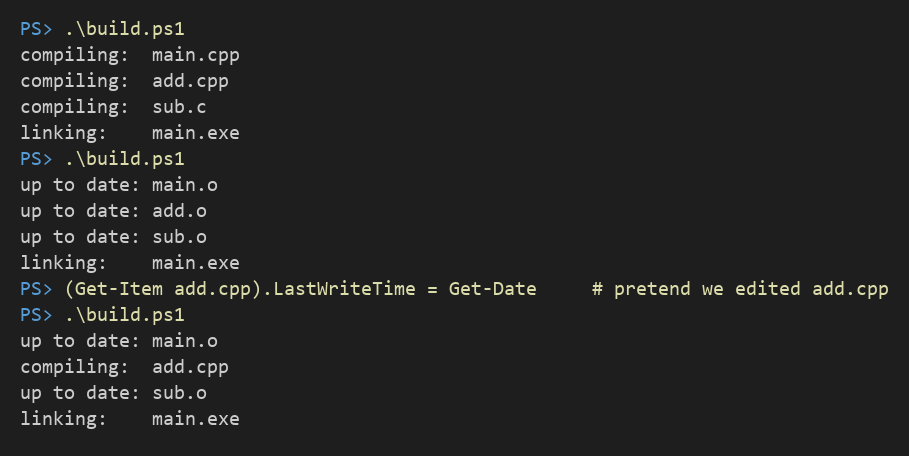
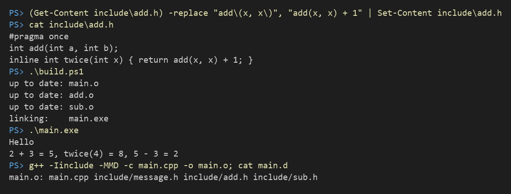

# Step 18 — A build script, and why "rebuild only what changed" is hard

## Goal
Our build is now 4 commands (`g++ -c` ×2, `gcc -c`, link). We put them in a script that only recompiles
**what changed** (an *incremental build*) — and discover the classic bug that build tools exist to solve.

## Changes in this commit
- New file `build.ps1` (15 lines): for each source, compile only if its `.o` is **missing or older** than the source; then link.
  ```powershell
  function Build-Object($compiler, $src, $obj) {
    if ((Test-Path $obj) -and (Get-Item $obj).LastWriteTime -ge (Get-Item $src).LastWriteTime) {
      Write-Host "up to date: $obj"; return
    }
    Write-Host "compiling:  $src"
    & $compiler -Iinclude -c $src -o $obj
    if ($LASTEXITCODE -ne 0) { exit 1 }
  }
  Build-Object g++ main.cpp main.o
  Build-Object g++ add.cpp add.o
  Build-Object gcc sub.c sub.o
  g++ main.o add.o sub.o -o main.exe
  ```
- This doc file, 3 images, and one line in the README.

## Concepts
- **Incremental build**: separate compilation (Step 11) means each `.o` depends only on its own source.
  If `add.cpp` didn't change since `add.o` was made, `add.o` is still correct → skip it.
- "Did it change?" is decided by **timestamps**: is the target (`add.o`) newer than its input (`add.cpp`)?
- The link step always runs here (to keep the script short). Real tools also skip it when no `.o` changed.
- ⚠ The **input** of `main.o` is not only `main.cpp`: it is everything `main.cpp` **includes** (`message.h`, `add.h`, `sub.h`).
  Our script ignores headers → after a header change it builds a **wrong program without any error**.

## Do it by hand (PowerShell, in the repo root)

### 0. Allow the script to run
Windows blocks `.ps1` scripts by default (execution policy `Restricted`). Run it with a one-time bypass:
```powershell
powershell -ExecutionPolicy Bypass -File .\build.ps1
```
(Or once, for your user: `Set-ExecutionPolicy -Scope CurrentUser RemoteSigned` — then `.\build.ps1` works.)



### 1. Incremental build
Start clean, build twice, then "touch" one source:
```powershell
del main.o, add.o, sub.o
.\build.ps1
.\build.ps1
(Get-Item add.cpp).LastWriteTime = Get-Date     # pretend we edited add.cpp
.\build.ps1
```
Expect:
- 1st run: `compiling:` all 3 sources, then `linking:`.
- 2nd run: `up to date:` all 3 — nothing compiled.
- 3rd run: only `compiling:  add.cpp`.



(`git status` stays clean afterwards: the rebuilt `.o` files are identical to the committed ones.)

### 2. The header bug
Change the **header** only — `twice` now returns `x + x + 1` — and rebuild:
```powershell
(Get-Content include\add.h) -replace "add\(x, x\)", "add(x, x) + 1" | Set-Content include\add.h
.\build.ps1
.\main.exe
```
Expect: all 3 `up to date`, and the program still prints **`twice(4) = 8`** instead of `9`. ❌
No error, no warning: `main.o` was compiled with the **old** `add.h`, and the script didn't know `main.o` depends on it.

How does a real build tool know? It asks the **compiler**, which knows exactly which headers it opened:
```powershell
g++ -Iinclude -MMD -c main.cpp -o main.o; cat main.d
```
Expect: a file `main.d` with one rule:
```
main.o: main.cpp include/message.h include/add.h include/sub.h
```
`-MMD` = "while compiling, also write the list of **my own headers** (not system headers) into a `.d` file".
This line is written in **Makefile syntax** — next step. (After this command `main.o` was rebuilt, so `.\build.ps1` + `.\main.exe` now print `twice(4) = 9`.)



**Undo the experiment**: `git checkout include\add.h`, `del main.d`, and run `.\build.ps1` again — it says `up to date: main.o`
and the program still prints `9`: the script never looks at headers, so it can't notice the header changed **back** either.
Delete the object to force it: `del main.o; .\build.ps1`. Incremental builds are tricky.

## Errors you may hit at this step

| What you do | Message | Meaning |
|---|---|---|
| `.\build.ps1` with the default policy | `build.ps1 cannot be loaded because running scripts is disabled on this system` | PowerShell security setting, not a build error. Use `-ExecutionPolicy Bypass -File` |
| Edit a header, run the script | No error, **wrong output** (`twice(4) = 8`) | Missing header dependency → stale `.o`. The worst kind of build bug: silent |
| Run the script from another folder (`..\build.ps1` from a subfolder) | `compiling:  main.cpp` then `cc1plus.exe: fatal error: main.cpp: No such file or directory` | The script uses paths relative to the **current folder**: run it from the repo root |
| A compile error in one file | The compiler's error, then the script stops (`exit 1`), no link | Without `exit 1`, the script would link the **old** `.o` and hide the error |
| `git checkout` / `git pull` changes a file | Rebuild decisions look random | Git sets the file time to "now" when it writes a file, which may be newer or older than your `.o` files |

👉 Next step: **Make** — a tool built exactly for this: targets, dependencies, timestamps, and `.d` files.
