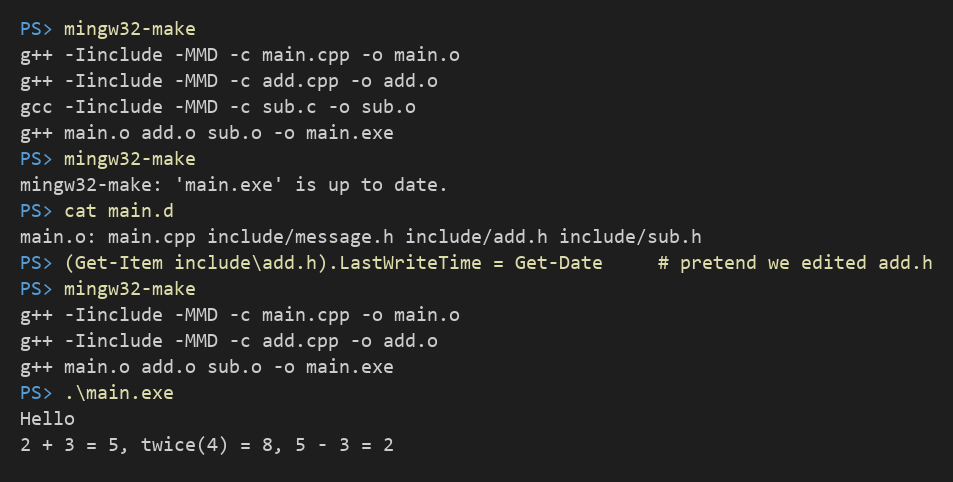
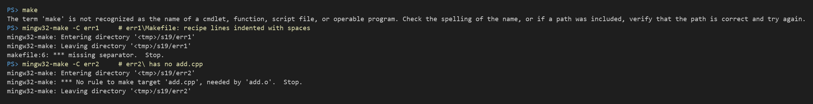

# Step 19 — Make: targets, dependencies, and automatic header tracking

## Goal
Replace `build.ps1` with **Make**, the classic build tool. Make does what our script did (compare timestamps),
plus what it couldn't: **follow header dependencies**, using the `.d` files the compiler writes (Step 18).

## Changes in this commit
- New file `Makefile` (21 lines):
  ```makefile
  CXX      = g++
  CC       = gcc
  CPPFLAGS = -Iinclude -MMD

  main.exe: main.o add.o sub.o
  	$(CXX) $^ -o $@

  main.o: main.cpp
  	$(CXX) $(CPPFLAGS) -c $< -o $@

  add.o: add.cpp
  	$(CXX) $(CPPFLAGS) -c $< -o $@

  sub.o: sub.c
  	$(CC) $(CPPFLAGS) -c $< -o $@

  .PHONY: clean
  clean:
  	del main.exe main.o add.o sub.o main.d add.d sub.d

  -include main.d add.d sub.d
  ```
- This doc file, 2 images, and one line in the README.

## Concepts
A Makefile is a list of **rules**:
```makefile
target: prerequisites
<TAB>recipe (the command that makes the target)
```
Make rebuilds `target` **only if** it is missing, or **older than any prerequisite** — and it does this recursively:
to make `main.exe` it first checks `main.o`, `add.o`, `sub.o`, each against their own prerequisites.

```
main.exe ◀── main.o ◀── main.cpp, include/message.h, include/add.h, include/sub.h   (from main.d)
         ◀── add.o  ◀── add.cpp, include/add.h                                     (from add.d)
         ◀── sub.o  ◀── sub.c, include/sub.h                                       (from sub.d)
```

| Syntax | Meaning |
|---|---|
| `CXX = g++` | A variable, used as `$(CXX)` |
| `$@` | The **target** of the rule (`main.o`) |
| `$<` | The **first** prerequisite (`main.cpp`) |
| `$^` | **All** prerequisites (`main.o add.o sub.o`) |
| `-MMD` in `CPPFLAGS` | Each compile also writes `X.d` = a rule `X.o: X.cpp <headers>` (Step 18) |
| `-include main.d ...` | Read those rules into the Makefile. `-` = don't complain if they don't exist yet (first build) |
| `.PHONY: clean` | `clean` is a command name, not a file to create |

The **first** rule in the file (`main.exe`) is the default goal of `mingw32-make`.

## Do it by hand (PowerShell, in the repo root)

On this MinGW installation, Make is called **`mingw32-make`** (there is no `make.exe`).
Without `sh.exe` in `PATH`, it runs recipes with `cmd.exe` — that's why `clean` uses `del`, not `rm`.

```powershell
mingw32-make clean
mingw32-make
mingw32-make
cat main.d
(Get-Item include\add.h).LastWriteTime = Get-Date     # pretend we edited add.h
mingw32-make
.\main.exe
```
Expect:
- 1st `mingw32-make`: Make **prints each command** it runs: 3 compiles + 1 link.
- 2nd: `mingw32-make: 'main.exe' is up to date.` — nothing to do.
- `main.d`: `main.o: main.cpp include/message.h include/add.h include/sub.h`
- After touching `add.h`: **`main.o` and `add.o`** are recompiled (both include `add.h`), `sub.o` is not, then link.
  The Step 18 bug is gone.



Useful options: `mingw32-make -n` (dry run: print the commands, run nothing — like `g++ -###` in Step 02),
`mingw32-make -j4` (run up to 4 recipes **in parallel** — possible because the `.o` files are independent),
`mingw32-make -C <dir>` (run in another folder).

`git status` will show `main.d`, `add.d`, `sub.d` as new files: they are generated, like `.o` files.

## Errors you may hit at this step



| What you do | Message | Meaning |
|---|---|---|
| Type `make` | `The term 'make' is not recognized...` | MinGW names it `mingw32-make` |
| Recipe lines indented with **spaces** | `makefile:6: *** missing separator.  Stop.` | Recipes **must** start with a real TAB character. Check your editor (VS Code: "Indent Using Tabs" for Makefiles) |
| A prerequisite file doesn't exist (e.g. `add.cpp` deleted) | `*** No rule to make target 'add.cpp', needed by 'add.o'.  Stop.` | Make can't find the file and has no rule to create it |
| A compile error | The compiler error, then `mingw32-make: *** [makefile:9: main.o] Error 1` (lowercase: on Windows Make looks for `makefile` first, and the file system ignores case) | Make stops at the first failing recipe. The target is **not** updated |
| `mingw32-make clean` twice | `Could Not Find ...\main.exe` (from `del`), but exit code 0 | `del` complains about missing files; harmless |
| Rename a header that a `.d` file still lists | `*** No rule to make target 'include/old.h', needed by 'main.o'` | Stale `.d` file. Run `mingw32-make clean` (GCC's `-MP` flag prevents this) |

👉 Last step: **CMake** — instead of writing build rules, describe the project and let CMake generate them.
