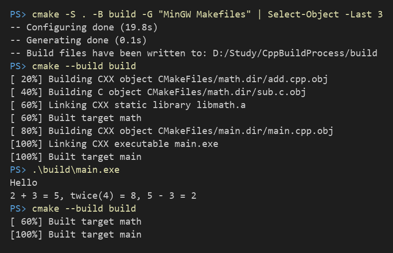
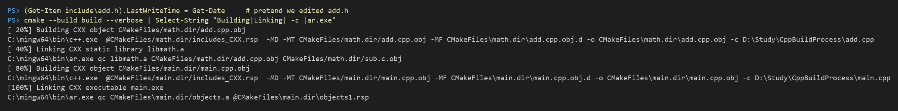
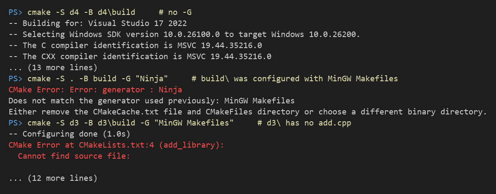
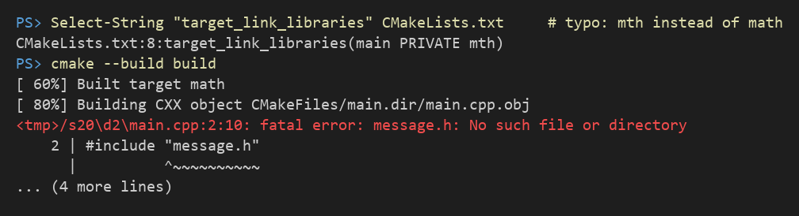

# Step 20 — CMake: describe the project, generate the build

## Goal
With Make we still wrote every command (`g++ -Iinclude -MMD -c ...`). **CMake** works one level higher:
you **describe** the project (which files make a library, which make a program, who uses what),
and CMake **generates** the build files (a Makefile, a Ninja file, or a Visual Studio solution) for you.
This is how most real C++ projects are built today.

## Changes in this commit
- New file `CMakeLists.txt` (8 lines):
  ```cmake
  cmake_minimum_required(VERSION 3.16)
  project(CppBuildProcess C CXX)

  add_library(math STATIC add.cpp sub.c)
  target_include_directories(math PUBLIC include)

  add_executable(main main.cpp)
  target_link_libraries(main PRIVATE math)
  ```
- `.gitignore`: 1 line added: `build/` — the build folder CMake generates has hundreds of files.
- This doc file, 4 images, and one line in the README.

## Concepts
### Two phases
```
CMakeLists.txt ──(1) configure + generate: cmake -S . -B build -G "MinGW Makefiles"──▶ build\Makefile ...
                                                                                       │
                     (2) build: cmake --build build  (runs mingw32-make in build\) ◀───┘
                                  └─▶ g++ -c ... (Step 04) ─▶ ar (Step 15) ─▶ link (Step 07)
```
- **Configure**: CMake finds your compilers (tests them!), reads `CMakeLists.txt`, and writes build files into `build\`.
- **Build**: the generated build system runs the same tools you used by hand in Steps 04–19.
- **Out-of-source build**: everything generated goes to `build\`. Your source folder stays clean. `rmdir build -Recurse` = full clean.

### Targets and "usage requirements"
| Line | Meaning | What we did by hand |
|---|---|---|
| `add_library(math STATIC add.cpp sub.c)` | A static library from 2 sources. CMake knows `.c` → C compiler, `.cpp` → C++ | `g++ -c`, `gcc -c`, `ar rcs libmath.a` (Steps 11, 14, 15) |
| `target_include_directories(math PUBLIC include)` | `math` needs `-Iinclude`, **and so does everyone who uses `math`** (`PUBLIC`) | `-Iinclude` on every command (Step 10) |
| `add_executable(main main.cpp)` | A program | `g++ -c main.cpp` + link |
| `target_link_libraries(main PRIVATE math)` | `main` uses `math`: link it, **in the right order**, and inherit its `PUBLIC` include folders | `main.o -L. -lmath` (Step 16) |

Header dependencies are automatic: CMake compiles with `-MD -MF xxx.d` (like `-MMD` in Steps 18–19).

## Do it by hand (PowerShell, in the repo root)

### 1. Configure and build
```powershell
cmake -S . -B build -G "MinGW Makefiles"
cmake --build build
.\build\main.exe
cmake --build build
```
Expect:
- Configure: many `--` lines (compiler detection takes ~20 s the first time), ending with
  `-- Build files have been written to: D:/Study/CppBuildProcess/build`.
- Build: `Building CXX object .../add.cpp.obj`, `Building C object .../sub.c.obj`, `Linking CXX static library libmath.a`,
  `Building CXX object .../main.cpp.obj`, `Linking CXX executable main.exe`. (CMake names objects `.obj`.)
- The program prints the same 3 lines as always.
- Second build: only `Built target math` / `Built target main` — nothing to do.



### 2. See the real commands: `--verbose`
```powershell
(Get-Item include\add.h).LastWriteTime = Get-Date     # pretend we edited add.h
cmake --build build --verbose | Select-String "Building|Linking| -c |ar.exe"
```
Expect: `add.cpp` and `main.cpp` are recompiled (both include `add.h`; `sub.c` doesn't), and you can read the **exact commands**:
```
C:\mingw64\bin\c++.exe @CMakeFiles/math.dir/includes_CXX.rsp -MD -MT ... -MF ...add.cpp.obj.d -o ...add.cpp.obj -c D:\Study\CppBuildProcess\add.cpp
C:\mingw64\bin\ar.exe qc libmath.a CMakeFiles/math.dir/add.cpp.obj CMakeFiles/math.dir/sub.c.obj
```
Everything from this tutorial is there: `-c` (Step 04), `-MD`/`-MF` dependency files (Step 18), `ar` (Step 15).
The include folder hides in a "response file": `cat build\CMakeFiles\main.dir\includes_CXX.rsp` → `-ID:/Study/CppBuildProcess/include`
— `main` got it from `math` through `PUBLIC`, although we never wrote it for `main`.



## Errors you may hit at this step



| What you do | Message | Meaning |
|---|---|---|
| Forget `-G "MinGW Makefiles"` | `-- Building for: Visual Studio 17 2022` / `The CXX compiler identification is MSVC ...` | No error, but CMake picked **another compiler** (Microsoft's, because Visual Studio is installed on this PC). The default generator depends on what is installed — always pass `-G` |
| Re-configure `build\` with another generator | `Error: generator : Ninja` / `Does not match the generator used previously: MinGW Makefiles` | A build folder is tied to one generator. Delete `build\` or use another folder |
| A source file listed in `CMakeLists.txt` doesn't exist | `CMake Error at CMakeLists.txt:4 (add_library): Cannot find source file: add.cpp` | Reported at **configure** time, before any compiler runs |
| Typo in `target_link_libraries(main PRIVATE mth)` | `main.cpp:2:10: fatal error: message.h: No such file or directory` | Surprise: a **compile** error! `mth` isn't a target, so `main` didn't inherit `math`'s `PUBLIC` include folder. (If the include folder were set on `main` too, you'd get the link error `cannot find -lmth` instead) |
| Run `cmake --build build` before configuring | `Error: D:/Study/CppBuildProcess/build is not a directory` | Run the configure command (`cmake -S . -B build ...`) first |
| `.\main.exe` after building with CMake | Runs the **old** `main.exe` from Steps 18–19 | CMake builds into `build\`. Run `.\build\main.exe` |



## 🎓 The whole journey
| Step | You learned | Tool |
|---|---|---|
| 01–03 | One command hides 4 stages; keep the intermediate files | `g++`, `-v`, `-save-temps` |
| 04–07 | Run every stage by hand; symbols, relocations, the C runtime | `-E -S -c`, `as`, `ld`, `nm`, `objdump` |
| 08–10 | The preprocessor copies, replaces and removes text | `#include`, `#define`, `-D`, `-I`, `-H` |
| 11–14 | Translation units, declarations vs definitions, ODR, mangling | `nm`, `c++filt`, `extern "C"` |
| 15–17 | Libraries: static (link time) vs dynamic (load time), link order | `ar`, `-L -l`, `-Wl,-Map`, `-shared` |
| 18–20 | Automating the build correctly | script, Make, CMake |

When a build fails, ask **"which stage?"**: preprocessor (`fatal error: X: No such file`), compiler (`error: ... was not declared`),
assembler (`Assembler messages`), linker (`undefined reference` / `multiple definition`), or loader (`DLL was not found`).
The tool name in the message (`cc1plus`, `as`, `ld`, `collect2`, Windows) tells you where to look.
